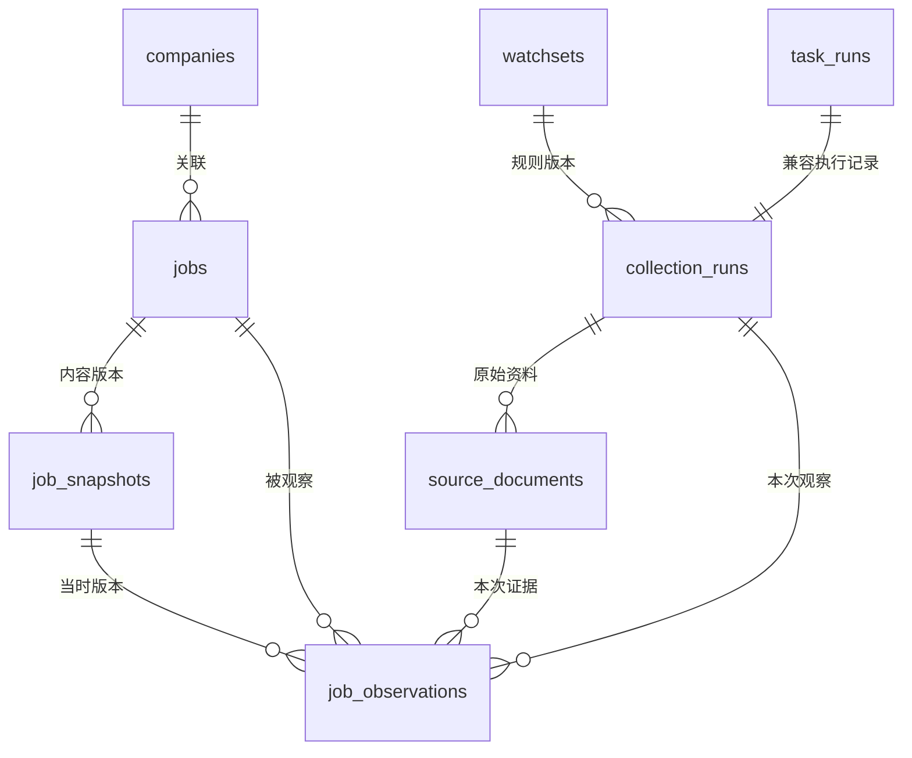

> 2026-11-19：以下原八表历史字段保持。当前head为`fb04c8e96034`，完整业务库23表；0.5新增字段与表见[研究与产品增量字段](研究与产品增量字段.md)，迁移已核对原19表全部旧列行值不变。

# 数据库最终字段定义

> 2026-11-19 完整产品增量说明：原八表全部旧列和行值保留，当前完整迁移为 `e8b1f5c4a086`，共19张业务表。下文详细保留原八表定义和历史迁移证据；新增11表与研究检查点定义见[研究与产品增量字段](研究与产品增量字段.md)，升级及完整备份恢复见[使用与部署](完整产品使用与部署.md)。

确定日期：2026 年 11 月 18 日。迁移版本：`e7b4c1a20618`。

本轮确定七类业务表，并兼容保留原有 `task_runs`，物理表共八张。新增公司表，补齐岗位主表；不建立 `job_access_contexts`，最新岗位访问参数放在 `jobs`。内容版本沿用现有 `job_snapshots` 表名与外键，避免仅为更名搬动历史。

本阶段以静态职位内容和可靠采集时间为主，不增加定时任务、长期状态巡检、研究 Agent 或前端。已有执行记录先保留，后续需要合并时单独迁移，不在本轮删除历史。

范围说明：上句记录的是本次字段落地阶段。后续轻量应用与候选研究 Goal 以 [最新项目方案](项目方案.md) 为准；本轮需求更新不改本文件的表字段、不执行迁移，也不将后续研究能力误写为已经实现。

后续 MVP 实施补充：CLI 的筛选、人工补录、研究及保存已完成，没有新增表或迁移，版本仍为 `e7b4c1a20618`。已有字符串列新增业务取值：`jobs.source/companies.source=manual`，`collection_runs.mode=manual`、`kind=manual_import`、`transport=manual`，`source_documents.transport/response_origin` 与观察来源为 `manual`。人工导入与 live 或 replay 可共存，live 与 replay 仍不混库。人工 `observed_at` 是导入时间，`source_fetched_at` 未核实则为空；`provenance.related_job_id` 可记录关联，人工正文不覆盖平台记录。`stats.requests_attempted` 对人工批次表示一次本地处理，`remote_tool_calls=0`，不冒充平台请求。研究结果文件不是新增业务事实、知识或检查点表。详见 [MVP 使用与验收](MVP使用与验收.md)。

## 数据规则

- 时间为带时区的 UTC ISO 8601 字符串。首次发现、取得详情、本地处理、网站发布时间各自独立；没有真实发布时间就为空。
- `jobs` 提供可以直接用 SQL 筛选的当前字段；非空来源字段按各自观察时间更新，较旧响应不覆盖新值，详情空城市/空标签不清掉已有列表信息。
- 沿用 `job-content-v1` 的快照内容合同与去重键；同内容复用版本，每次取得的观察另记，A→B→A 可以复用 A。没有扩大版本提取范围而造成一次性重复快照。新增展示字段仍保存在原始响应中。
- 有平台公司编号才按编号归并；没有编号时每个来源岗位建立 `unverified` 公司关联，不能仅因同名就断定同一公司，也不把临时记录数当作已核实企业数。
- 账号 Cookie 与安全令牌不进入业务表。岗位访问参数仅限本机内部使用；CLI 不导出平台岗位编号、公司来源编号或访问上下文。
- `response_origin=unknown` 表示来源新鲜度不明。MCP 成功返回不证明绕过连接器缓存，回放也不是新的市场观察。
- 静态采集阶段，`status=unknown` 是合法结果；没有明确状态、没有搜到、认证失败、网络失败均不推断关闭。`invalidStatus=true` 的枚举意义未单独证实，不单凭它改状态。

## 关系



## 公司 `companies`

| 字段 | 类型 | 可空 | 默认 | 定义与关联 |
| --- | --- | --- | --- | --- |
| `id` | `VARCHAR` | 否 | `—` | 内部记录编号（主键）；主键 |
| `source` | `VARCHAR` | 否 | `—` | 来源平台，目前为 boss |
| `source_company_id` | `VARCHAR` | 是 | `—` | 平台提供的公司或品牌编号；缺失时为空，不冒充法定主体编号 |
| `identity_key` | `VARCHAR` | 否 | `—` | 内部去重键：有来源编号用 id:编号，否则用 job:来源岗位编号 |
| `identity_status` | `VARCHAR` | 否 | `—` | source_id 为有来源编号；unverified 为未核实的临时关联 |
| `name` | `VARCHAR` | 否 | `—` | 来源展示公司名称 |
| `industry_raw` | `VARCHAR` | 是 | `—` | 行业原文 |
| `scale_raw` | `VARCHAR` | 是 | `—` | 规模原文 |
| `stage_raw` | `VARCHAR` | 是 | `—` | 融资或发展阶段原文 |
| `introduction` | `TEXT` | 是 | `—` | 来源公司介绍 |
| `first_observed_at` | `VARCHAR` | 否 | `—` | 首次取得该记录的时间，不是网站发布时间 |
| `last_observed_at` | `VARCHAR` | 否 | `—` | 最近取得该记录的时间，不证明来源实时性 |

唯一约束：`source, source_company_id`；`source, identity_key`。
索引：`name`。

## 岗位当前信息 `jobs`

| 字段 | 类型 | 可空 | 默认 | 定义与关联 |
| --- | --- | --- | --- | --- |
| `id` | `VARCHAR` | 否 | `—` | 内部记录编号（主键）；主键 |
| `source` | `VARCHAR` | 否 | `—` | 来源平台，目前为 boss |
| `source_job_id` | `VARCHAR` | 否 | `—` | 来源岗位编号；与 source 联合唯一 |
| `first_observed_at` | `VARCHAR` | 否 | `—` | 首次取得该记录的时间，不是网站发布时间 |
| `last_observed_at` | `VARCHAR` | 否 | `—` | 最近取得该记录的时间，不证明来源实时性 |
| `company_id` | `VARCHAR` | 是 | `—` | 关联公司；无公司资料时允许为空；外键 `companies.id` |
| `company_name_raw` | `VARCHAR` | 是 | `—` | 本次来源显示的公司名，独立保留，避免后续公司更名改写历史原文 |
| `title` | `VARCHAR` | 是 | `—` | 岗位名称 |
| `job_url` | `VARCHAR` | 是 | `—` | 去除查询参数及片段的详情页网址 |
| `employment_type` | `VARCHAR` | 是 | `—` | 来源已归一化的全职/兼职/实习等用工类型 |
| `raw_job_type` | `INTEGER` | 是 | `—` | 来源原始岗位类型数值，不作为招聘是否关闭的依据 |
| `days_per_week_raw` | `VARCHAR` | 是 | `—` | 来源每周出勤天数原文 |
| `least_month_raw` | `VARCHAR` | 是 | `—` | 来源最低实习月数原文 |
| `pay_type_raw` | `VARCHAR` | 是 | `—` | 来源计薪方式原文 |
| `recruitment_count_raw` | `VARCHAR` | 是 | `—` | 招聘人数原文，未知则空 |
| `source_position_code` | `VARCHAR` | 是 | `—` | 来源职位分类编号 |
| `source_position_name` | `VARCHAR` | 是 | `—` | 来源职位分类名称 |
| `city` | `VARCHAR` | 是 | `—` | 工作城市 |
| `district` | `VARCHAR` | 是 | `—` | 工作区县 |
| `address` | `VARCHAR` | 是 | `—` | 来源工作地址 |
| `salary_raw` | `VARCHAR` | 是 | `—` | 薪资原文，始终作为解释依据 |
| `salary_min` | `NUMERIC(12, 2)` | 是 | `—` | 识别格式的薪资金额下限 |
| `salary_max` | `NUMERIC(12, 2)` | 是 | `—` | 识别格式的薪资金额上限 |
| `salary_currency` | `VARCHAR` | 是 | `—` | 当前识别的标准人民币薪资格式填 CNY，未识别则空 |
| `salary_unit` | `VARCHAR` | 是 | `—` | month/year/day/hour；BOSS 标准 K/万无显式周期按月薪格式解释 |
| `salary_months` | `INTEGER` | 是 | `—` | 明确披露的薪资月数；不按未披露的 12 薪补造 |
| `experience_raw` | `VARCHAR` | 是 | `—` | 经验要求原文 |
| `experience_min_years` | `NUMERIC(4, 1)` | 是 | `—` | 明确经验区间下限 |
| `experience_max_years` | `NUMERIC(4, 1)` | 是 | `—` | 明确经验区间上限；不限/应届等不强行填零 |
| `education_raw` | `VARCHAR` | 是 | `—` | 学历要求原文 |
| `education_level` | `VARCHAR` | 是 | `—` | 可识别的来源学历层级，未识别则空 |
| `description_text` | `TEXT` | 是 | `—` | 完整职位描述正文 |
| `source_skills` | `JSON` | 是 | `—` | 来源技能标签数组，不是模型推断 |
| `welfare_tags` | `JSON` | 是 | `—` | 来源福利标签数组 |
| `job_labels` | `JSON` | 是 | `—` | 来源其他岗位标签数组 |
| `detail_state` | `VARCHAR` | 否 | `list_only` | list_only 只有摘要；detail 已成功取得完整详情 |
| `status` | `VARCHAR` | 否 | `unknown` | unknown/active/closed；仅来源明确状态可更新，不由搜索缺席或错误推断 |
| `source_status_raw` | `JSON` | 是 | `—` | 最近明确确认状态时使用的来源状态字段 |
| `status_observed_at` | `VARCHAR` | 是 | `—` | 最近明确确认招聘状态的时间 |
| `first_closed_observed_at` | `VARCHAR` | 是 | `—` | 首次明确发现关闭的时间，不是平台实际关闭时间 |
| `source_published_at` | `VARCHAR` | 是 | `—` | 来源明确提供、含时区的发布时间，统一转 UTC；没有则空 |
| `source_published_raw` | `VARCHAR` | 是 | `—` | 来源发布时间原文，如相对日期；不强行换算成精确时间 |
| `last_seen_in_search_at` | `VARCHAR` | 是 | `—` | 最近取得包含该岗位的列表响应时间，需结合响应来源判断是否新鲜 |
| `detail_collected_at` | `VARCHAR` | 是 | `—` | 最近成功取得详情的时间；不等于网站内容更新时间 |
| `content_updated_at` | `VARCHAR` | 是 | `—` | 当前业务字段实际改变所依据的观察时间 |
| `access_context` | `JSON` | 否 | `{}` | 最近一组岗位访问参数，security_id/lid/job_url；仅内部使用，不放账号 Cookie |
| `access_captured_at` | `VARCHAR` | 是 | `—` | 最近一组访问参数的取得时间，不代表到期时间 |
| `field_observed_at` | `JSON` | 否 | `{}` | 各字段组最后采用的观察时间，防止旧响应覆盖新值 |
| `field_document_ids` | `JSON` | 否 | `{}` | 各字段组对应的原始资料编号，便于追溯混合来自列表和详情的当前值 |

唯一约束：`source, source_job_id`。
索引：`city, status`；`company_id`；`first_observed_at`。

## 岗位内容版本（沿用原物理表名） `job_snapshots`

| 字段 | 类型 | 可空 | 默认 | 定义与关联 |
| --- | --- | --- | --- | --- |
| `id` | `VARCHAR` | 否 | `—` | 内部记录编号（主键）；主键 |
| `job_id` | `VARCHAR` | 否 | `—` | 所属内部岗位编号；外键 `jobs.id` |
| `kind` | `VARCHAR` | 否 | `—` | list 或 detail，列表与详情分别保存，不冒充同一份完整响应 |
| `content_version` | `VARCHAR` | 否 | `—` | 内容提取/去重规则版本，目前 job-content-v1 |
| `content_sha256` | `VARCHAR` | 否 | `—` | 该规则下的内容摘要，用于复用相同内容 |
| `payload` | `JSON` | 否 | `—` | 该版本的来源业务字段；不含访问参数、账号凭据或模型推断 |
| `first_document_id` | `VARCHAR` | 否 | `—` | 首次取得此内容版本的原始资料编号；外键 `source_documents.id` |
| `created_at` | `VARCHAR` | 否 | `—` | 本地创建记录的时间 |

唯一约束：`job_id, kind, content_version, content_sha256`。
索引：`job_id`。

## 轻量岗位观察 `job_observations`

| 字段 | 类型 | 可空 | 默认 | 定义与关联 |
| --- | --- | --- | --- | --- |
| `id` | `VARCHAR` | 否 | `—` | 内部记录编号（主键）；主键 |
| `collection_run_id` | `VARCHAR` | 否 | `—` | 所属采集批次；外键 `collection_runs.id` |
| `job_id` | `VARCHAR` | 否 | `—` | 所属内部岗位编号；外键 `jobs.id` |
| `snapshot_id` | `VARCHAR` | 否 | `—` | 本次看到的内容版本，关联 job_snapshots；外键 `job_snapshots.id` |
| `document_id` | `VARCHAR` | 否 | `—` | 本次实际收到的原始资料，不总是版本首次来源；外键 `source_documents.id` |
| `kind` | `VARCHAR` | 否 | `—` | list 或 detail；本阶段不加入周期状态巡检 |
| `page` | `INTEGER` | 否 | `—` | 搜索页码；不适用时按现有约定保存 |
| `position` | `INTEGER` | 是 | `—` | 列表页内位置；详情为空，不解释为招聘热度 |
| `access_context` | `JSON` | 否 | `—` | 兼容保留的本次访问上下文，不参与内容版本去重；当前可用参数另投影到 jobs |
| `observed_at` | `VARCHAR` | 否 | `—` | 取得响应的时间；回放保留原采集时间 |
| `processed_at` | `VARCHAR` | 否 | `—` | 本地处理该观察的时间，与响应时间分开 |
| `response_origin` | `VARCHAR` | 否 | `unknown` | website/cache/replay/client_error/test/unknown；MCP 成功不等于实时网站响应 |

唯一约束：`collection_run_id, job_id, kind, page`。
索引：`collection_run_id`；`job_id, observed_at`。

## 原始资料索引 `source_documents`

| 字段 | 类型 | 可空 | 默认 | 定义与关联 |
| --- | --- | --- | --- | --- |
| `id` | `VARCHAR` | 否 | `—` | 内部记录编号（主键）；主键 |
| `collection_run_id` | `VARCHAR` | 否 | `—` | 所属采集批次；外键 `collection_runs.id` |
| `kind` | `VARCHAR` | 否 | `—` | list/detail/client_error；客户端错误不伪装为平台响应 |
| `page` | `INTEGER` | 是 | `—` | 搜索页码；不适用时按现有约定保存 |
| `source_job_id` | `VARCHAR` | 是 | `—` | 来源岗位编号；整页列表可为空，不与内部 job_id 混用 |
| `request` | `JSON` | 否 | `—` | 脱敏后的调用参数；仍可能含岗位访问标识，仅本地保存 |
| `provenance` | `JSON` | 否 | `—` | 来源/回放等声明，未知事实不补造 |
| `path` | `VARCHAR` | 否 | `—` | 本地原始 JSON 文件路径；不把大响应正文重复放入本表 |
| `sha256` | `VARCHAR` | 否 | `—` | 实际原始文件字节的完整性摘要 |
| `observed_at` | `VARCHAR` | 否 | `—` | 取得响应的时间；回放保留原采集时间 |
| `archived_at` | `VARCHAR` | 否 | `—` | 本地归档时间 |
| `transport` | `VARCHAR` | 否 | `mcp` | 连接方式，mcp 或后续适配器明确声明的 http |
| `response_origin` | `VARCHAR` | 否 | `unknown` | website/cache/replay/client_error/test/unknown；MCP 成功不等于实时网站响应 |
| `source_fetched_at` | `VARCHAR` | 是 | `—` | 能确认的来源首次获取时间；无法判断缓存时为空 |

索引：`collection_run_id`。

## 采集规则版本 `watchsets`

| 字段 | 类型 | 可空 | 默认 | 定义与关联 |
| --- | --- | --- | --- | --- |
| `id` | `VARCHAR` | 否 | `—` | 内部记录编号（主键）；主键 |
| `name` | `VARCHAR` | 否 | `—` | 规则名称，例如 ai-dev |
| `version` | `INTEGER` | 否 | `—` | 同名规则的不可变版本号 |
| `config_sha256` | `VARCHAR` | 否 | `—` | 完整配置摘要，复用相同配置版本 |
| `config` | `JSON` | 否 | `—` | source/kind/query/city/page_limit/detail_limit/request_limit；含固定或探索组声明 |
| `created_at` | `VARCHAR` | 否 | `—` | 本地创建记录的时间 |

唯一约束：`name, version`；`name, config_sha256`。

## 采集批次 `collection_runs`

| 字段 | 类型 | 可空 | 默认 | 定义与关联 |
| --- | --- | --- | --- | --- |
| `id` | `VARCHAR` | 否 | `—` | 执行编号，与兼容 task_runs.id 一对一关联；主键；外键 `task_runs.id` |
| `watchset_id` | `VARCHAR` | 否 | `—` | 本批使用的具体规则版本；外键 `watchsets.id` |
| `mode` | `VARCHAR` | 否 | `—` | live 或 replay，数据库不混用两种模式 |
| `status` | `VARCHAR` | 否 | `—` | 运行状态：running/success/partial/failed/needs_auth |
| `started_at` | `VARCHAR` | 否 | `—` | 本次执行开始时间 |
| `finished_at` | `VARCHAR` | 是 | `—` | 本次执行结束时间；执行中为空 |
| `coverage` | `JSON` | 否 | `—` | 逐页、逐详情的实际进度与覆盖有限标记 |
| `stats` | `JSON` | 否 | `—` | 收到记录数、去重新增数、详情数和调用尝试数，不能当全市场岗位总数 |
| `issues` | `JSON` | 否 | `—` | 经过分类的错误摘要，不放认证信息或来源错误全文 |
| `stop_reason` | `VARCHAR` | 是 | `—` | 完成、达到预算或失败停止原因 |
| `source` | `VARCHAR` | 否 | `boss` | 来源平台，目前为 boss |
| `transport` | `VARCHAR` | 否 | `mcp` | 连接方式，mcp 或后续适配器明确声明的 http |
| `kind` | `VARCHAR` | 否 | `collection` | 目前为 collection，不代表已经实现定时调度 |


## 兼容执行记录（不是新增业务表） `task_runs`

| 字段 | 类型 | 可空 | 默认 | 定义与关联 |
| --- | --- | --- | --- | --- |
| `id` | `VARCHAR` | 否 | `—` | 内部记录编号（主键）；主键 |
| `kind` | `VARCHAR` | 否 | `—` | 目前为 collection，仅保留原执行记录，不实现调度/租约/队列 |
| `status` | `VARCHAR` | 否 | `—` | 运行状态：running/success/partial/failed/needs_auth |
| `started_at` | `VARCHAR` | 否 | `—` | 本次执行开始时间 |
| `finished_at` | `VARCHAR` | 是 | `—` | 本次执行结束时间；执行中为空 |


## 执行与验证

`db-init` 显式执行增量迁移和历史回填；采集命令不会静默改表。原始岗位、快照、观察、响应文件和运行记录全部保留。回填仅从现有本地档案读取，不请求 BOSS、不调用模型。

2026 年 11 月 18 日实际升级结果：

| 项目 | 正式库 `data/app.db` | 原回放库 `data/m1-replay-verification.db` |
| --- | --- | --- |
| 迁移版本 | `e7b4c1a20618` | `e7b4c1a20618` |
| 岗位／已回填标题 | 15／15 | 15／15 |
| 已有完整正文 | 2 | 2 |
| 公司关联记录 | 15，均缺少来源公司编号、标为未核实 | 15，均标为未核实 |
| 内容版本／观察记录 | 17／34，原记录完整保留 | 17／34，原记录完整保留 |
| 原始资料／采集批次 | 6／2，原记录完整保留 | 6／2，原记录完整保留 |
| 可靠来源发布时间 | 0，未补造 | 0，未补造 |

升级前最终备份位于 `data/backups/final-before-schema-20261118T134442Z/`。验证报告位于 `data/schema-verification/20261118/final/schema-verification.public.json`，均被 Git 忽略。原有各表的全部旧列值逐行核对一致，外键检查、SQLite 完整性检查与 Alembic 模型一致性检查通过。

真实 M0 档案在隔离的升级后回放库再次处理，取得 15 条列表、2 条详情，新增岗位和内容版本均为 0，外部调用为 0；没有把回放当成新的平台连通。67 项隔离测试、Ruff 及格式检查通过。
迁移前使用 SQLite backup API 备份正式库与回放库，备份包含 WAL 已提交内容。回退使用这些备份，不自动执行会删除业务字段的 downgrade。
验证包括空库建表、旧结构带数据升级、重复升级、外键、模型与迁移一致、字段投影、空值/旧响应保护、公司归并及匿名隔离、访问参数成组保存、实际档案迁移和真实样例回放。测试模拟来源仅验证机制，不冒充新平台连通。

```powershell
uv run --locked work-observer db-init
uv run --locked work-observer db-stats
uv run --locked work-observer jobs
uv run --locked work-observer companies
uv run --locked work-observer job --id <内部岗位编号>
```
