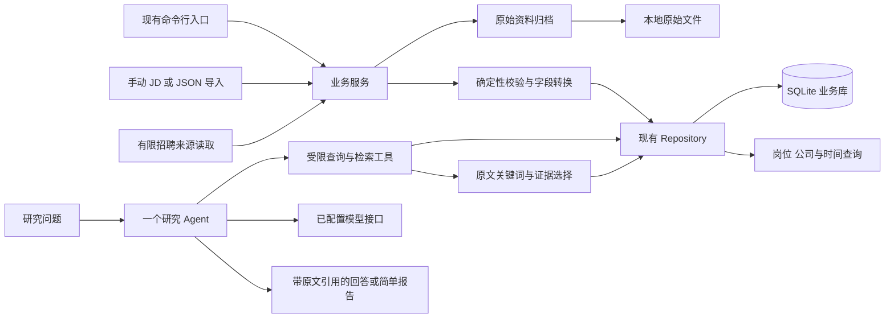

> 0.5.0阶段更新（2026-11-19）：已增量实现持久多轮项目与有界调查、分层/冲突/有效期记忆、统一原文检索、领域关系、业务质量审核、领域观察和资料核对。当前仍为Alpha；真实质量复验保留待审与失败，未宣称整体成熟。最新操作、分级证据与剩余实质缺口统一见[持久研究项目与阶段验收](持久研究项目与阶段验收.md)。以下0.4及更早状态按历史阶段理解。

# Work Observer 当前架构与模块边界

> 最新授权：按 [完整产品验收台账](完整产品验收清单.md) 继续建设完整产品；长期设计恢复为分阶段实施依据。保持单研究 Agent、普通业务服务、SQLite业务事实与独立研究检查点。G6 正增量加入持久研究与业务记忆，后续阶段补画像、评测、收件箱与部署；以下“本轮不做/未来需要”仅描述旧轻量首版，不能覆盖新的授权。实际实现与迁移进度随各阶段验收更新。

## 0. 当前0.4.0实际结构（2026-11-19）

已完成的完整业务入口为页面、CLI和Starlette HTTP；三者复用同一业务服务。SQLite当前迁移`e8b1f5c4a086`，原八表行值完整保留，新增11表分别承担记忆、画像、策略评测、任务、通知、公开网页与截图索引。完整字段见[增量字段](研究与产品增量字段.md)。

| 模块 | 当前责任 |
| --- | --- |
| research/agent + store | 单研究Agent、固定范围/快照池、短引用到不可变来源的校验、累计预算、独立检查点、暂停恢复、候选与固定反馈 |
| retrieval/catalog + enhanced / research/history | SQL筛选与未知分类、原文片段、历史截止的来源重建、别名、完整分母字面统计、两个详情版本差异 |
| analysis/profiles | 六类工作画像、领域候选及人工纠正、求职者向招聘方核实的缺口、版本缓存、显式个人条件匹配 |
| memory/service + lifecycle | 偏好/纠正/知识版本、来源核对、候选采纳、有界召回、撤回及遗忘的派生关联闭包 |
| tracking/evaluation | 当前基线与候选配对、锁定模拟开发集/门槛/回归、接受/拒绝/不足、显式启用与护栏回退 |
| tasks/service / reports/inbox | 规则版本、有限任务/重试/进度、默认关闭的每日时段、显式worker、来源失败与变化摘要、本地未读和后续问题 |
| connectors/public_search + public_documents | 有界搜索；仅搜索返回URL可由Agent读取，固定公网IP/TLS校验、重定向/正文大小预算、独立原文归档 |
| connectors/manual + import_drafts | 文本/JSON/CSV及截图；明确同意才单次视觉抽取，草稿人工核对后入库，回链原图 |
| api/web + product + operations + imports + schema + security | 中文页面薄入口、动态OpenAPI、离线接口说明、同源/Host/CSRF、可选单用户令牌与签名会话 |
| maintenance / storage/database + locks | SQLite备份与迁移旧值保护、完整包校验及新目录恢复、同库研究/采集/服务互斥、本地诊断 |

业务事实、派生分析、个人意图和执行上下文分开；模型没有自由SQL、命令、认证恢复、发布、投递或联系权限。研究提出候选不能自行生效或改评测门槛；固定评测是模拟检索机制，不代表真实市场或开放语义质量已经验证。

网络调用不持数据库事务。单用户API同时只执行一个研究/画像/抽取/评测/采集操作，普通查询可继续；操作系统锁同时防CLI/API跨进程重叠。没有借用框架名字声称具备未实现能力，也没有将LangGraph、多Agent或向量库作为前提。

当前来源暂停在网络前拦截。可本机运行，部署模式为私有单用户后端配固定HTTPS Origin和口令；没有实际公网发布、多用户权限或长期招聘无人采集验收。部署边界见[使用说明](完整产品使用与部署.md)。

**以下章节保留CLI MVP/G5的历史架构边界；其中“当前/本轮/未来”指当时阶段，最新实现以上述0.4结构为准。**

版本：轻量首版架构说明，2026 年 11 月 18 日更新。

当前需求以 [项目方案](项目方案.md) 为准，字段以 [数据库字段定义](数据库字段定义.md) 为准。原完整模块、调度、记忆和自我改进设计保存在 [长期架构设计](长期架构设计.md)，不要求本轮或后续一个 Goal 全部实现。

本文在需求更新后随已授权的 MVP 实施同步。现已完成 CLI 的筛选、手动导入、原文检索、单研究 Agent 和简单结果保存，具体入口和证据见 [MVP 使用与验收](MVP使用与验收.md)。

随后已授权的 G5 增加 `api/web.py` 与本地静态页面，复用下列业务模块；入口为 `serve`，默认仅监听 `127.0.0.1:8765`。用户操作、来源可信及保存语义保持不变，详见 [本地页面使用与验收](本地页面使用与验收.md)。本次不改变业务库结构。

## 1. 保持的基本决定

- 继续 Python／uv 单项目，复用现有 SQLite、SQLAlchemy、Alembic、Typer 和来源适配代码；不改用 Go 语言，不重写已通过验收的功能。
- 一个研究 Agent 配合固定业务流程。采集、校验、归档、去重、字段投影和统计由普通程序执行。
- SQL 与 RAG 协作：SQL 处理筛选和统计，关键词／原文检索提供解释证据，模型负责基于证据研究和比较。
- 业务库与原始文件是事实依据。未来的知识、偏好和长期记忆归业务存储，研究检查点另管，不以聊天上下文代替业务库。
- 首版先使用现有 CLI；HTTP API、产品前端、常驻 worker 不是当前前置条件。需要时在单独明确的目标中增量添加。
- 不在数据库事务内等待网络或模型；每次保存保持短事务。保持单次有界执行，不先引入并发采集或通用任务平台。

## 2. 已有能力与计划能力

| 能力 | 当前事实 | 后续轻量目标 |
| --- | --- | --- |
| 本地页面 | G5 已提供岗位、公司、补录、比较研究、原文核对和结果查看；Starlette/Uvicorn 复用现有锁定版本 | 先验证实际使用，不扩展公网平台 |
| SQLite 与迁移 | 已落地公司、岗位当前字段、版本、观察、原始资料及执行记录 | 复用，不删库重建 |
| CLI 查询 | jobs 支持 SQL 筛选、总体计数与未知标记；job/company/history/source 可核对资料 | 继续按实际使用改进 |
| 有限采集 | 已有 MCP 采集，及真实 HTTP 详情转换／入库 | 通过统一业务入口按需获取，失败不阻塞本地功能 |
| 原始资料与时间 | 已有归档、版本和来源关联 | 保持缓存、回放、手动和未知时间的正确语义 |
| 资料补充 | import-jd 支持文本／JSON，手动来源、原文归档与去重复用既有表 | 持续资料用稳定人工 ID 维护版本 |
| 本地检索与比较 | SQL 范围、关键词证据检索及 compare 已实现 | 语义检索按需要再扩展 |
| 研究 Agent | query_jobs/search_evidence/read_job/finish_research 受限循环已实现 | 默认 10 次调用／180 秒，不引入复杂编排 |
| 结果留存 | reports 中按需保存 JSON 与 Markdown，冻结范围、版本、引用和分析 | 业务知识／长期记忆仍归业务库，本次不预建 |
| 长期自动运行 | 后台令牌更新有单次成功，最近批量访问仍失败 | 暂不继续研究；恢复和定时留给单独目标 |

## 3. 轻量首版的数据流

图中本地业务闭环已经实现；招聘来源当前暂停，保留适配代码并在进入网络前检查本地风险记录。没有定时入口、并行 Agent 或自动恢复服务。

## 4. 来源适配的边界

统一的是业务字段与档案，连接实现不绑定为唯一 MCP 路径：

- 现有 MCP 提供工具入口及已可用能力，先保留，不为改用 HTTP 而删除其安装或已有配置。
- 已验证的 HTTP 详情可复用连接器的底层代码；来源原始 JSON 与归一化内容分别保存，不伪装为 MCP 原始返回。
- 两种入口使用同一业务库和规则，同一账号操作受统一预算与停止条件约束，不并发争用同一会话。
- 后台浏览器只作为可选的凭据准备能力。单次成功不代表账号永久有效，也不代表当前访问暂停已恢复。
- 暂不新增认证守护进程、凭据续期任务、旧岗位参数刷新器或全量状态巡检。后续联网目标必须明确范围和验收，不能以“完成应用”为由持续线上试错。

## 5. 各模块只承担必要职责

| 模块 | 输入 | 输出与边界 |
| --- | --- | --- |
| api/web.py 与 api/assets | 本机页面操作与受限 HTTP 请求 | 复用 Repository、Catalog、导入、研究与报告逻辑；无采集／认证／任意文件读取入口 |
| collection | 指定搜索范围或已选岗位、调用预算 | 一次有界读取与执行结果，不在内部扩成无限采集 |
| connectors | 搜索条件／访问参数 | 原始响应、来源与错误；不直接生成研究结论 |
| storage | 经校验的业务字段与原始资料引用 | 公司／岗位当前信息、去重版本、观察及执行记录 |
| connectors/manual.py | 用户提供的 JD 文本／JSON | 独立人工来源、可选原岗位关联；不覆盖平台原文 |
| retrieval/catalog.py | 岗位条件、关键词及有限候选数 | 参数化 SQL、总体口径、带观察及版本引用的正文片段 |
| research/agent.py | 一个问题、有限工具与预算 | 一个模型循环，有引用的判断、缺口与结束原因，不改原始事实 |
| reports/results.py | 研究结果及证据引用 | 按需保存 JSON／Markdown 文件及再次查看，不建设通知系统 |

Agent 只能通过明确工具访问数据，不能随意执行 SQL 写入、修改来源配置、扩大固定采样范围或无限调用招聘来源。普通数据库查看与采集不需要模型参与。

## 6. 表与事实的归属

沿用八张物理表，详见字段文档：companies、jobs、job_snapshots、job_observations、source_documents、watchsets、collection_runs，以及兼容 task_runs。

- jobs 是当前业务字段；job_snapshots 保存已有内容版本，不再复制一套 Job Versions。
- job_observations 保存某批采样在何时看到哪个版本，不复制全文，给 Agent 提供时间和采样范围证据。
- source_documents 保存原始文件索引，支持核对和重提取，原文文件仍在 data/raw。
- 搜索规则版本与采集批次说明采样范围及执行是否完整，避免将任务失败当作市场变化。
- 最新岗位访问参数在 jobs，账号 Cookie 与安全令牌继续加密独立管理。
- 简单研究产物按需保存结果文件，包含问题、候选口径、所读版本、原文和分析；本次没有增加表。它不是业务知识库或长期记忆，也不是研究检查点。
- 人工导入使用现有执行、档案、版本、观察与公司关联；新增 manual 来源／模式／连接／响应来源取值，不需要改变 SQLite 列结构。live 与 replay 的分库约束保持。

数据库中未知的发布时间、招聘状态、公司身份保持未知，模型不能补成来源事实。统计以去重岗位与明确候选范围为基础；缺少正文的岗位不进入需要正文的要求占比分析。

## 7. 后续执行方式

后续可使用 Goal 模式，每个目标仅覆盖一个可验收的业务结果：资料查看与筛选、简单导入、最小研究问答、简单结果保存。候选划分见项目方案。

不再要求先完成旧 M2 定时及长期认证，再允许推进分析和研究。已有 M0／M1 及字段迁移成果继续使用；完整调度、检查点恢复、长期记忆与自我改进分别在需要时进入独立目标。

复杂持久化研究确实出现时再采用相应编排与独立检查点，不将 LangGraph 全套机制作为最小工具循环的必装前提。向量检索、多服务和多 Agent 同样按真实需求决定。

本轮 R01–R09 CLI 实施已有明确授权并已验收；来源恢复、定时、前端等后续方向仍需单独确定范围，不因目录占位或长期方案而自动开工。

后续 G5 本地页面现已完成。单次研究以当前服务进程中的有界异步任务执行，同时只接受一个运行；普通读取仍可用。最多保留 20 次运行，用户点击保存后才写原格式结果文件。没有增设任务表、持久队列、常驻调度平台或研究检查点；进程退出会中断未完成研究。
