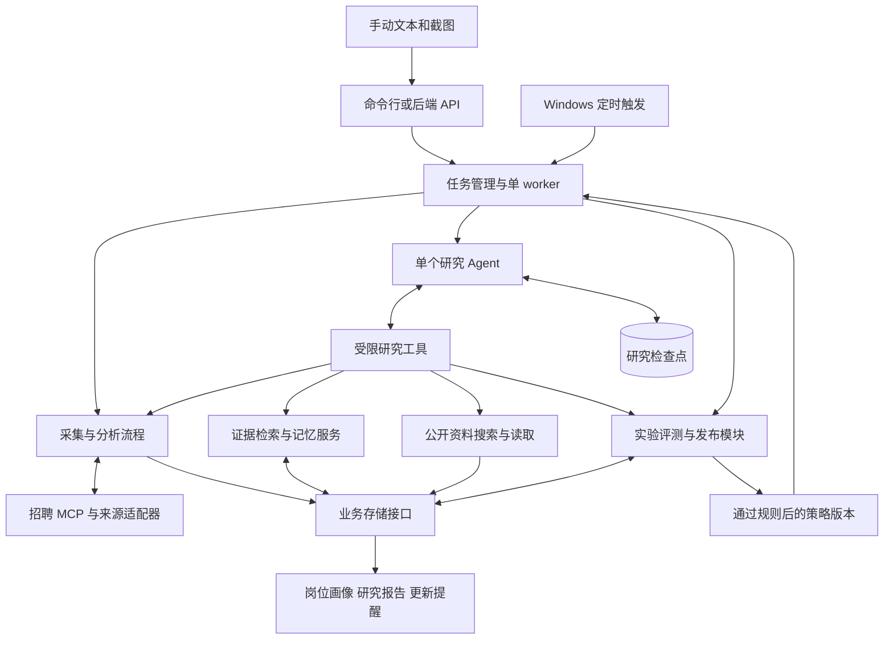
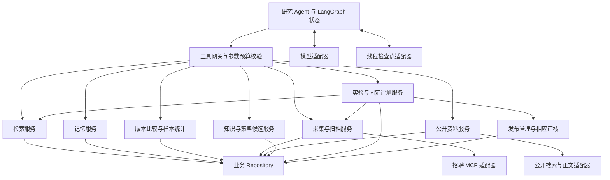
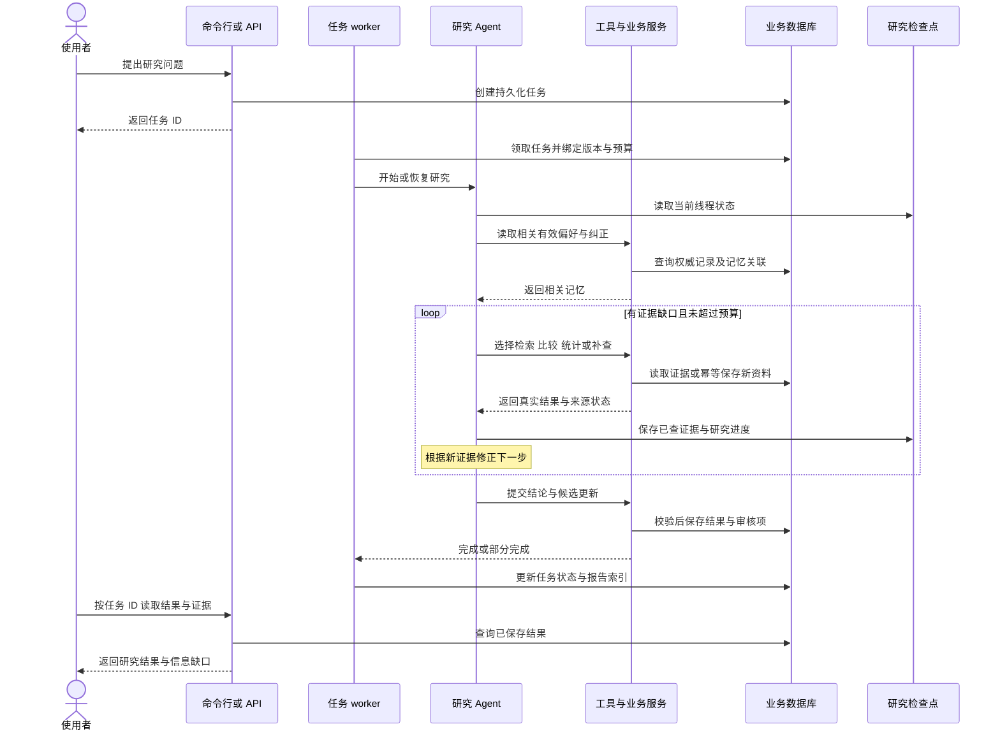
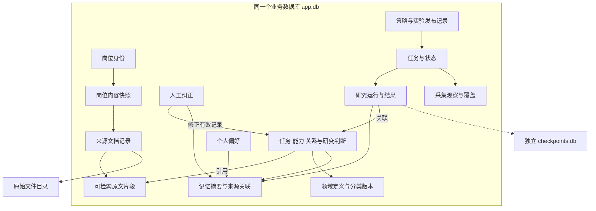
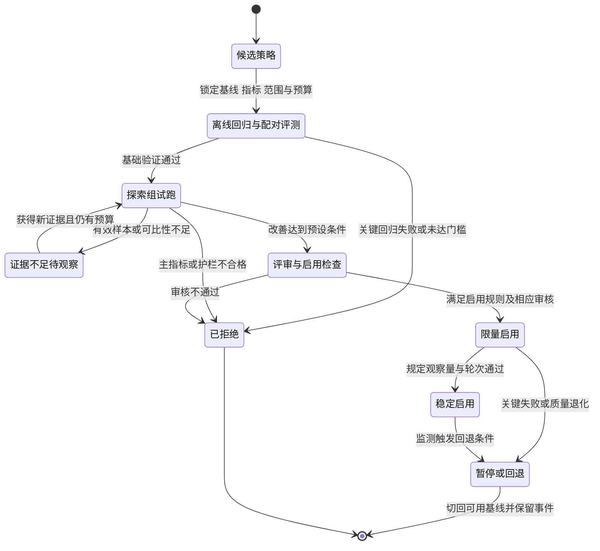

# 招聘市场与职业演化 Agent 长期架构设计

> 2026-11-19 最新状态：本文件重新作为完整产品的分阶段设计依据，已授权并持续实施；下面“本轮只更新/不创建Goal”等为旧轻量阶段历史，不覆盖当前执行。实际单用户实现共用业务服务、单研究Agent、SQLite业务库与独立检查点，没有机械引入全部远期框架。最新结构及验收见[当前架构](架构与模块设计.md)和[完整台账](完整产品验收清单.md)。

归档说明（2026 年 11 月 18 日）：本文保留原完整模块与流程设计，表示后续可选演进，不要求轻量首版一次实现。当前边界以 [项目方案](项目方案.md) 和 [架构与模块设计](架构与模块设计.md) 为准。本轮仅更新需求，不创建 Goal、不启动实现或部署。

版本：第一版开发架构。日期：2026 年 11 月 17 日。

本设计将[项目方案](项目方案.md)落实为开发边界：一个后端项目、一个研究 Agent、一个长任务 worker；使用业务数据库、原始文件和研究检查点保存不同类型的数据。先接一个招聘来源，前端后续设计。图中的模块不代表独立微服务或独立 Agent。

本文中的图是总体目标设计。当前已实现 M0 连接检查与 M1 的有限手动采集、档案和业务存储，验收见 [M1 采集档案](M1采集档案.md)；Agent、调度与后续模块尚未实现。无人值守认证条件仍未解决，允许据实调整来源适配方式，其他业务边界保持稳定。

2026 年 11 月 18 日岗位存储字段已确定并迁移，具体表、列和关联以 [数据库字段定义](数据库字段定义.md) 为准。以静态职位内容和采集时间为当前重点，长期状态复查不作为本轮阻塞项；后台令牌更新的单次实验不代表长期无人值守验收通过。

## 一 系统总览

这张图表示任务如何进入、由谁执行、数据流向哪里，以及研究产物怎样影响下一轮。所有来源读取都经过适配器；图中省略模型供应商连接的细节。

后台程序按策略执行搜索、存储、比较和统计。Agent 决定具体研究的问题拆解、工具选择、证据补查与停止条件。Agent 生成的领域认识、候选策略和记忆更新通过业务服务保存；候选策略经过实验和启用流程后，才能影响下一轮正式任务。

首版实际运行单元如下：

| 运行单元 | 责任 | 运行方式 |
| --- | --- | --- |
| 命令行入口 | 手动采集、导入、研究、查看与审核 | 用户启动；定时任务也可调用批处理命令 |
| API 进程 | 接收请求、提交任务、读取结果 | 后续前端复用，同样可用接口文档操作 |
| 单个 worker | 顺序执行采集、分析、研究与实验等长任务 | 从持久化任务记录领取；命令行独立批处理不能与 worker 同时执行同一任务 |
| 招聘 MCP 服务 | 提供允许的搜索和详情工具 | 按实际配置连接本地或远程服务，M0 验证 |
| 外部模型与搜索接口 | 模型推理与公开资料补查 | 通过适配器访问，受预算与超时约束 |

定时任务负责触发，后台服务负责执行，不要求聊天窗口一直开启。主机与连接器会话仍需满足来源运行条件。

## 二 Agent 与工具模块

这张图表示代码调用关系。Agent 的所有动作进入工具网关，校验参数、来源、范围和预算，再委托现有业务模块执行。采集程序、命令行和 API 也复用这些模块，不各写一套规则。

### 模块合同

| 模块 | 输入 | 输出与所有权 |
| --- | --- | --- |
| 任务管理 | 任务类型、范围、参数、执行时段 | 任务 ID、状态、租约、进度；不负责推断岗位含义 |
| 来源适配器 | 标准化搜索参数或岗位访问标识 | 标准结果、原始响应与错误；不直接决定领域分类或写研究结论 |
| 采集与归档 | 观察配置、列表与详情结果 | 岗位身份、观察记录、原文与快照；负责去重和来源归属 |
| 分析与知识服务 | 原文、结构版本、分类定义与修正 | 工作画像、证据、判断、分类建议；负责业务知识的校验与版本 |
| 检索服务 | 问题、范围、时间规则、候选数量 | 有来源与快照的证据包；读取数据，不直接改事实 |
| 记忆服务 | 用户与研究作用域、问题主题、显式修改或候选 | 有效偏好、纠正、摘要及变更；权威数据仍由相应业务表持有 |
| 比较与统计 | 明确的岗位集合、时间与查询版本 | 确定性差异、统计数和分母；不把检索前几条当样本全集 |
| 研究运行器 | 目标、已有证据、相关记忆与预算 | 工具行动、结论、证据缺口、候选更新及检查点 |
| 实验与评测 | 基线、候选、锁定合同和资料范围 | 指标、回归、用量、待观察或通过理由；不接受候选自改门槛 |
| 发布管理 | 评测、试用结果及必要审核 | 有效策略版本、上一稳定版本、发布或回退事件 |
| 报告服务 | 已保存的画像、判断、统计和变更 | 可追溯报告与未读提醒；记录采用的数据、知识和策略版本 |

模型抽取属于分析模块，可以多次调用模型，但不构成额外 Agent。语义质量需要证据核对与人工抽查，结构校验不能证明内容为真。

### 写入规则

Agent 不直接执行自由 SQL、任意系统命令或改动发布指针。检索与统计工具只读取；采集工具通过归档服务写入；知识和记忆修改通过对应业务服务校验；发布和回退通过发布模块完成。策略候选不能修改评测集或评分门槛。

知识、偏好和纠正维护各自的权威记录。摘要与检索索引保存来源引用，不能成为可以独立修改的第二套事实。

## 三 一次研究怎样执行

以下是同步小任务的正常路径：每次工具调用都实际读取或处理资料，返回结果后 Agent 才决定下一步。研究步骤数量和顺序由证据决定，服务权限与预算由程序决定。

### 单 worker 下的长任务规则

查询、读取少量资料等有界工具动作可在当前 worker 任务内直接调用业务服务。需要长时间运行的采集或实验，工具提交独立任务后立即返回任务 ID；当前研究保存检查点并进入等待状态，释放 worker。子任务完成后，由任务管理创建恢复研究的任务。

不能在单 worker 中提交一个子任务后持续阻塞等待，否则子任务没有执行机会。需要人工标注或审核时同样挂起，收到结果再恢复；不以循环查询消耗预算。

Agent 运行状态与任务领取租约是两件事：LangGraph 检查点管理研究上下文，任务表管理进程调度与恢复。外部调用和模型等待不放进数据库事务；业务写入使用唯一约束与幂等键，应对恢复后的重复调用。

## 四 数据与记忆归属

这张图表达逻辑关系，不是最终建表 SQL。原始材料、工作知识、记忆与运行状态分开管理；多张截图或资料可以共同支持同一个岗位快照。

图中的业务数据库可以通过关联表与结构化字段实现关系，不另建图谱库。知识库是其中可检索、可引用的资料与知识集合；RAG 是读取这些内容辅助回答的过程。记忆服务从这里读取有效知识、偏好和摘要，不再复制一套独立事实库。

| 存储 | 内容 | 保留与派生关系 |
| --- | --- | --- |
| app.db | 岗位与观察、资料元数据、片段、判断、领域、纠正、偏好、记忆、任务、评测和发布 | 权威业务记录与必要派生关联，保存版本 |
| data/raw | 原始响应、正文和截图文件 | 数据库保存路径、指纹和来源，保留核对依据 |
| checkpoints.db | 研究线程状态、已执行步骤和恢复位置 | 不替代岗位与知识记录；按任务保留策略清理 |
| reports | 报告文件 | 从数据库生成的结果，保留使用的数据、知识和策略版本 |
| 后续可选检索索引 | 向量等辅助索引 | 可由原始材料与片段重建，不能作为唯一事实存储 |

任务表负责通用执行信息，采集运行与研究运行保存各自的专用信息。每次运行绑定观察配置、策略与分析版本，区分市场变化、采样变化和分析方法变化。

## 五 策略改进怎样启用和回退

研究 Agent 负责提出候选与解释，固定评测器按锁定规则验证。以下状态属于策略生命周期，不是多个 Agent 的角色。

新关键词的实际增量需要真实搜索试跑；离线回放只验证已有资料上的行为，不能补造没有采集过的历史结果。探索组不改变固定组的统计分母。普通质量波动达到事先规定的退化门槛才回退，关键规则破坏立即暂停；认证或网络故障另记为来源运行问题。

发布管理保存当前版本与上一稳定版本，切换采用短事务。回退保留原始材料与历史，标记受影响的方法记忆、判断和报告；基线也不可用时保持故障状态。具体指标和判例以项目方案的自我改进章节为准。

## 六 开发顺序映射

| 里程碑 | 主要模块 | 先验证什么 |
| --- | --- | --- |
| M0 | 配置、MCP 与模型适配器 | 独立程序真实连通，取得字段与错误样例 |
| M1 | 采集、归档、业务 Repository | 一页列表、少量详情、两次运行去重与留痕 |
| M2 | 任务管理、定时入口、worker | 独立触发、租约、断点恢复和认证异常，开始积累历史 |
| M3 | 分析、知识、片段与证据 | 不同岗位的工作画像正确并能回到原文 |
| M4 | 检索、比较、偏好与纠正、评测基线 | 有证据的召回、清楚的样本口径和有效记忆读写 |
| M5 | 单研究 Agent、工具网关、记忆循环、实验 | 按证据决定下一步，提出并验证一个改进候选 |
| M6 | API、报告、发布与回退 | 无前端也可完整使用，长任务不死锁，策略与结果可追溯 |

先实施 M0 与 M1，不为全部图中模块提前建立空壳代码。真实连接结果可能改变来源适配器实现，但不改变证据追踪、权威存储、版本化和受控研究这些基本边界。

## 七 开发前确定的约束

1. 一套后端业务服务，命令行、API、定时任务和 Agent 工具复用。
2. 一个研究 Agent；评测与发布默认是固定程序，不另增自进化 Agent。
3. 一个长任务 worker；提交长子任务后挂起研究，避免同 worker 相互等待。
4. 业务库保存唯一权威记录，原始文件与检查点分别承担归档和运行恢复。
5. SQL 完成确定的筛选与统计，RAG 提供解释用证据，二者协作。
6. Agent 产物带来源、版本和状态，重大知识修改与固定组变更走相应审核。
7. 固定组与探索组分开，候选不能修改自己的验收门槛。
8. 首版是单机单任务 worker，API 提交与少量配置写入使用短事务；不在数据库事务中等待外部网络或模型。
