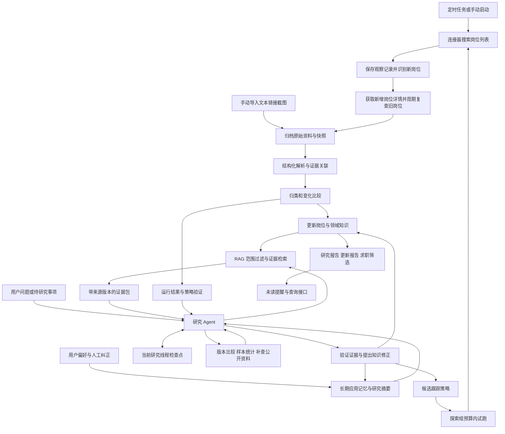

> 0.5.0阶段更新（2026-11-19）：已增量实现持久多轮项目与有界调查、分层/冲突/有效期记忆、统一原文检索、领域关系、业务质量审核、领域观察和资料核对。当前仍为Alpha；真实质量复验保留待审与失败，未宣称整体成熟。最新操作、分级证据与剩余实质缺口统一见[持久研究项目与阶段验收](持久研究项目与阶段验收.md)。以下0.4及更早状态按历史阶段理解。

# 招聘市场与职业演化 Agent 长期规划

> 2026-11-19 最新状态：用户已将本文件完整业务愿景纳入当前持续开发授权；下面的归档/轻量首版后置描述属于11月18日历史阶段，不再是永久排除项。现已分阶段实现研究、画像、记忆、检索评测、任务收件箱、资料补充及单用户部署，逐项证据与尚需外部环境的验收见[完整产品验收台账](完整产品验收清单.md)。认证与定时不作为研究前置条件，招聘暂停也没有解除。

归档说明（2026 年 11 月 18 日）：本文保留原完整设想，包含定时采集、长期记忆、自我改进、评测和发布等长期能力，不再作为轻量首版的全部必做清单。当前需求与执行范围以 [项目方案](项目方案.md) 为准。文中原“第一版”和 M0–M6 的顺序保留原讨论语境，不覆盖新的优先级；旧的“认证与定时必须先完成才能推进业务”等要求不再是当前首版前置条件。

版本：第一版开发方案，包含 RAG、分层记忆、自我改进评测与回退机制。日期：2026 年 11 月 17 日。

这是一款以招聘信息为主要证据，持续理解工作种类、职责结构和能力要求变化，并帮助个人理解这些变化意义的研究应用。系统需要梳理企业的业务背景与目标、需要完成的任务、承担任务的岗位、所需能力与使用工具，以及这些关系如何演进。

第一版包含自动采集、手动导入、历史快照、岗位分析、领域归类、RAG 证据检索、分层记忆、单个研究 Agent、个人筛选和更新报告。先通过命令行与后端接口交付，前端形式后续决定。最先验证独立程序能否持续获取真实招聘数据，再逐步完成检索、记忆与研究。

采用的架构是：固定采集与处理流程、结构化业务数据库、可追溯知识库、RAG 检索工具、任务与长期应用记忆，以及一个研究 Agent。首版使用 SQL 过滤、标签与关键词检索实现 RAG，向量检索在召回评测证明有需要时加入。记忆围绕本产品的任务、知识与个人偏好实现，不另行建设通用记忆平台。

开发前的系统总览、模块合同、研究时序、数据归属和策略状态图见[架构与模块设计](架构与模块设计.md)。图中的模块对应同一后端项目内的代码职责，首版维持一个研究 Agent 和一个长任务 worker。

## 一 产品范围与交付物

### 初始范围

服务首位使用者，也就是正在了解 AI 工作与技术转型机会的个人。先观察国内 AI 应用与 Agent 相关岗位，接一个招聘数据源，从一个城市开始。城市在配置里设置，初始可以用现有截图较多的上海；这是启动取样范围，不代表全国市场。

以相对稳定的搜索条件形成固定观察组。允许 Agent 提议新的关键词和搜索方向，作为单独的探索组。个人薪资底线与外包偏好用于筛选结果，不提前删除整个观察样本中的相关岗位。

### 第一版交付

| 交付物 | 使用方式 | 验证内容 |
| --- | --- | --- |
| 可定时执行的采集程序 | 自动执行列表搜索、详情获取和复查 | 无需每天手动发起聊天也能运行；失败有状态 |
| 岗位资料与历史档案 | 查询岗位原文、每次观察记录和版本 | 原始资料可追溯，重复运行不会重复造岗位 |
| 岗位工作画像与领域档案 | 查具体岗位，或比较一组岗位 | 区分任务、责任、能力与工具，判断有证据 |
| RAG 证据检索 | 根据问题检索符合时间与范围的岗位原文、快照和公开资料 | 相关证据可召回，来源与版本正确，结论可核对 |
| 分层应用记忆 | 跨研究保留偏好、知识与人工纠正，恢复当前任务 | 旧偏好可更新，错误可修正，过时记忆不冒充当前事实 |
| 可调用工具的研究 Agent | 输入问题，保存带证据的研究结果 | 能按问题选择补查与比较，资料不足时停止 |
| 更新报告与未读提醒 | 查看本次变化、日报和关注项 | 说明发生了什么、依据是什么、可能影响什么 |
| 个人求职筛选 | 按偏好生成候选和待核实清单 | 排除原因明确，未知信息不当成坏工作 |
| 命令行与 HTTP API | 运行任务、查看结果、纠正分类 | 在没有产品前端时仍能完整使用和演示 |

第一版不承担自动投递、联系招聘者、完整简历编辑或跨平台全量采集。后续可以围绕同一套岗位数据增加这些能力；当前优先保证采集和研究结果可信、持续可用。

## 二 第一版具体功能

### 自动采集与观察任务

创建观察任务，配置数据源、关键词、城市、采集频率、分页上限和调用预算。每次运行保存配置版本，记录成功页面、失败页面和停止原因。

固定观察组可以先包含 Agent、AI 应用、RAG、Harness 等搜索词；这是一组待验证的查询配置，实际关键词需要结合返回结果调整。不同查询中的同一岗位只计一次。查询条件修改后保留旧配置，报告注明观察范围变化。

采集分两层：

1. 列表观察记录岗位标识、标题、展示企业、地点、薪资、经验学历、列表标签与来源。
2. 详情采集优先处理新岗位，对已有岗位按周期复查完整 JD。列表不变时，详情正文仍可能改变。

列表位置变化只说明搜索结果排序变化，不直接解释为招聘热度上升。采集达到分页预算时，标记为覆盖有限；不能将已取到的结果称为全站全部岗位。

### 手动补充

支持 JD 文本、JSON 或 CSV、岗位链接和截图。手动与自动入口进入同一套档案。截图提取结果保留文件、原图区域或文字片段，以及人工修正。

如果链接所属网站尚无连接器，记录链接和用户提供的内容，不假装已取得完整网页。跨入口可能是同一岗位时，产生合并候选；缺少可靠标识时由使用者确认。

### 岗位工作画像

每个岗位至少回答：

- 企业在什么业务背景下，需要解决什么问题。
- 具体任务、预期交付物、独立负责或协作承担的责任。
- 必备与加分能力、经验要求，以及使用的框架、服务和工具。
- 可以归入哪些工作领域，为什么。
- 有哪些信息缺口，适合在面试时核实什么。

能力与工具分开记录。例如后端接口设计属于能力，某个 Web 框架属于工具；维护线上可靠性属于责任。提及某个技术词，不等于它是必备要求。

初始人工分类可以暂设为业务应用开发、执行平台与 Harness、领域决策系统、模型与推理部署、平台配置与实施。允许多标签和未分类状态，根据实际样本修正，避免强迫所有岗位落入预先画好的格子。

### 历史与变化

区分三种变化：

| 类型 | 例子 | 处理方式 |
| --- | --- | --- |
| 来源内容变化 | 同一岗位增加维护评估集的职责 | 保存新快照，记录新增要求 |
| 样本范围变化 | 新增城市、关键词、渠道或分页深度 | 标注范围变化，不直接推断行业趋势 |
| 分析方法变化 | 模型或分类规则更新后重新归类 | 保存分析版本，不冒充企业改了岗位 |

先支持单个岗位的版本比较，再支持同类岗位的集合观察。所有集合结论附时间范围、查询配置、有效详情样本数和来源覆盖情况。初期只报告当前画像、观察到的变动和待观察信号；不能凭一个新岗位宣布一个行业趋势。

某项要求的样本占比，应以具有可用详情且范围相符的岗位为分母，同时展示样本数。多标签分类需要注明岗位可能重复出现在不同领域，不把各领域计数直接相加。

### 研究与知识更新

支持提出具体问题，例如：这些 Agent 岗位的工作有什么不同，哪些要求与业务有关，最近新增的要求是什么，哪些岗位明确承担开发与上线责任。

研究结果保存问题、使用的材料、结论、反例、信息缺口和后续关注项。涉及企业业务背景时优先补查官网、产品文档和官方技术材料。外部材料只能支持其明确涉及的关系，不能把公司整体方向直接归到每个岗位上。

动态学习首先通过资料积累、关系修正、领域定义版本和人工反馈实现。新领域先生成候选，结合不同企业的实际任务和补充材料继续观察。涉及合并或拆分领域的调整，第一版由使用者审阅后应用；不需要训练模型。

### Agent 产生的数据与反馈循环

研究 Agent 也是数据生产者。除回答当前问题外，它还应产生可持久化的领域认识、研究假设、跟踪策略和过程记忆。这些产物经相应检查后，影响下一轮检索、采集和研究。

| Agent 产物 | 具体内容 | 如何进入下一轮 |
| --- | --- | --- |
| 领域认识 | 领域边界、任务与能力关系、同名岗位的差异 | 形成有依据的新知识或领域定义候选，修正后续归类与解释 |
| 研究判断与假设 | 初步解释、反例、尚未证实的变化信号 | 保存证据和状态，建立待研究问题，后续继续验证或撤回 |
| 跟踪策略 | 新搜索词、别名、来源组合、复查频率和补查条件 | 进入独立探索组试跑，保留策略与观察配置版本 |
| 研究过程记忆 | 哪种查询找到了相关材料、哪个来源失败、哪些取样方式存在偏差 | 关联真实运行结果，指导后续工具选择；方法是否有效单独评测 |
| 知识和记忆修正 | 更新旧理解、替代过时摘要、保留人工纠正 | 更新有效记录与派生摘要，标记受影响的报告和缓存 |

采集程序的执行机制保持明确，采集计划可以随研究演进。第一版跟踪策略以配置参数和允许的步骤组合表达，由工具执行与校验。原始招聘信息是外部观察数据；Agent 生成的判断与方法是派生数据，保留来源关系和验证状态，不能互相冒充。

### RAG 检索与证据回答

研究问题先确定时间、领域、城市、企业和观察组等范围，再检索岗位原文、历史快照和企业公开资料。把命中的内容连同来源、快照时间、证据位置和判断类型组成证据包，供模型回答和引用。Agent 可在证据不足时继续检索或补查。

RAG 的首版实现采用结构化过滤、规范标签、别名词表与关键词匹配，不依赖独立向量数据库。检索与生成相结合即可形成 RAG；SQL 数据库也可以作为检索工具的数据源。[RAG 与检索说明](https://docs.langchain.com/oss/python/deepagents/retrieval)

例如，询问“Agent 岗位是否更重视后端工程”，需要分别完成两件事：程序在明确样本全集上计算相关要求的分布，检索模块召回具有代表性的职责片段供模型解释。检索返回的前几个片段不能作为统计分母，也不能单独证明趋势。

### 记忆与持续纠正

分开保存当前研究的执行状态、已有研究知识、用户偏好和人工纠正。每次研究按问题读取相关记忆，不把全部历史对话放进上下文。

显式偏好和人工纠正可以直接形成新版本；模型推测出的偏好先形成待确认建议。用户改口后采用新的有效偏好，过去版本保留变更依据。用户要求忘记某条个人记忆时，停止默认召回并清理可删除的派生摘要与缓存；原始岗位档案按业务历史规则独立管理。

过去研究的摘要可用于继续研究，重要结论仍要回到原始证据。模型生成的报告和记忆摘要不能被反复当作独立证据，造成同一条材料被多次计数或推断自行强化。

### 求职筛选与更新提醒

个人筛选至少支持薪资底线、地点、用工形式、希望承担的工作和关注领域。分开输出条件不符、职业目标不符、信息待核实。外包、派遣或驻场需要来源明确支持；没写合同主体时记录未知。

薪资保留原文，另外解析月薪范围、薪资月数和不明确部分。标注的薪资上限、年终奖或额外薪数不能当作保证收入。第一版可以按月薪字段筛选，复杂收入比较留给明确披露的数据。

每次采集后生成更新报告。值得关注的变化形成未读提醒；无实质变化时只记录运行结果。提醒渠道先落到本地收件箱和报告，可通过命令行或 API 查看，前端接入后复用。Windows 桌面通知可以作为首版末的增强项，不依赖邮件或微信发送。

## 三 数据与证据设计

### 数据来源

| 数据 | 来源 | 用途 |
| --- | --- | --- |
| 岗位列表与详情 | 招聘连接器，第一版尝试现有 BOSS MCP | 自动发现岗位、获取要求、记录变化 |
| 截图与人工材料 | 用户提供的文件和文本 | 补齐连接器未覆盖的信息，建立评测样本 |
| 企业业务与产品资料 | 官网、产品文档、官方技术文章 | 解释招聘任务背后的业务背景 |
| 历史记录 | 系统从开始运行后逐次保存 | 版本比较与时间观察 |
| 分类和纠正记录 | 系统建议与使用者审核 | 更新领域定义和判断方法 |
| 个人偏好 | 用户配置 | 求职筛选与关注提醒 |

启动阶段的本地截图样本包含 19 个图片文件，未纳入公开仓库。图片数量不等于岗位数；同一岗位的多张截图需要合并核对。这批材料用于启动分析和人工验收，持续数据由自动采集产生。

### 建议的数据表

| 表 | 主要内容 |
| --- | --- |
| watchsets | 观察任务、固定或探索类型、查询配置与版本 |
| task_runs | 通用执行任务、类型、状态、计划时段、领取租约、进度及参数版本，关联专用运行记录 |
| collection_runs | 计划执行时段、运行状态、各页覆盖、错误、调用统计 |
| jobs | 内部岗位 ID、来源岗位 ID、展示企业、首次与最近观察时间 |
| job_observations | 某次运行在哪个查询或页面看到了哪个岗位，关联内容快照 |
| source_documents | 原始响应、正文、截图文件、来源与内容指纹 |
| document_chunks | 按职责条目或自然段拆分的检索片段、原文位置、来源类型、岗位与快照关联 |
| job_snapshots | 岗位各次不同的来源内容，关联原始资料和时间 |
| job_analyses | 快照对应的任务、责任、能力、工具、分析版本 |
| evidence | 证据原文、文档 ID、文字位置或截图区域 |
| claims | 单条判断、事实或推断类型、证据引用和审核状态 |
| taxonomy_versions | 领域、任务和能力词表的定义、关系与版本 |
| tracking_strategies | Agent 或使用者提出的跟踪策略、适用范围、来源依据、参数与版本 |
| strategy_experiments | 基线与候选版本、锁定的实验合同、探索采集、评测运行、预算与评审结论 |
| evaluation_suites | 开发集、保留验收集、关键回归案例、标注与评分规则的版本 |
| evaluation_runs | 基线与候选版本、资料快照、评测集与规则版本、指标、成本及人工复核 |
| strategy_releases | 启用范围、生效时间、当前版本、上一稳定版本、发布与回退原因 |
| research_runs | 问题、执行状态、工具调用、检查点、结果与用量 |
| retrieval_runs | 检索问题、范围过滤、命中片段与排序、索引版本和证据包 |
| change_events | 来源修改、样本变化、分析更新、解释和证据 |
| user_preferences | 筛选偏好与关注项 |
| corrections | 使用者对归类、抽取和解释的修正 |
| memory_items | 可召回的研究摘要或应用记忆，包含作用域、主体、依据、有效状态与版本 |
| memory_events | 记忆新增、更新、替代、撤回或遗忘的记录及关联修正 |
| reports_notifications | 报告、未读提醒和关联的变化事件 |

初期可以用 JSON 字段保存分析结构；需要稳定统计的领域、能力等标签再建立关联表。业务数据与 Agent 运行检查点分开保存，方便分别管理与排查。

`claims`、`taxonomy_versions`、`user_preferences` 和 `corrections` 是各自领域的权威记录。`memory_items` 只保存用于召回的摘要和关联，不复制出一套可以独立修改的岗位事实或偏好。摘要需要记录来源记录及版本；来源修正后更新或失效相应摘要。

检索片段至少关联文档、岗位、快照、来源类型、原文位置、采集时间和可用的发布时间。记忆至少包含用户或共享知识作用域、主体、内容、依据、状态、创建时间、适用时间和版本。发布时间或适用时间未知时留空，不用采集时间伪装成事实开始生效的时间。

### 身份与去重

同来源有稳定岗位 ID 时使用来源加岗位 ID 识别岗位。调用详情所需的访问标识可能变化，应与岗位身份分开存储，实际稳定性在连接验证时检查。

同岗位、相同内容指纹不重复创建内容快照，但仍保留本次观察记录。不同岗位 ID 却内容高度相似时，标记为疑似重复招聘，保留各自原始记录，不能仅凭标题自动合并。展示企业归一化与合同主体识别也分开处理。

### 时间与状态

分别保存来源标注的发布时间、首次观察时间、最后观察时间、采集时间和分析时间。来源没有发布时间时保留为空。截图文件修改时间不能当作岗位发布时间。

采集运行状态至少区分成功、部分成功、失败和需要重新认证。岗位区分已观察到、暂未再次观察到和来源明确标注关闭；搜索缺席不能直接推断撤招。

### 证据要求

每条关键判断关联具体证据片段；缺少支持时输出未知或待核实。判断类型至少区分原文明确陈述、跨材料归纳、研究推断。审核状态单独记录，避免用一个模型自报的置信分数代替证据。

分类规则、提示词、模型标识和数据结构版本都随分析结果保存。人工修正优先保留，自动重跑不得静默覆盖。报告中的结论引用具体判断，判断再引用原文，形成可追踪关系。

### 分层存储与默认读取

| 层次 | 主要记录 | 读取和更新规则 |
| --- | --- | --- |
| 业务事实与时间历史 | 原文、快照、观察记录 | 默认读取问题所需版本，保留原始来源；缺席或旧快照不等于当前状态 |
| 长期研究知识 | 领域定义、任务能力关系、判断、研究摘要 | 按问题召回；区分证据与推断；来源修正或知识版本变化后更新 |
| 用户记忆 | 明确偏好、关注项、人工纠正 | 跨研究读取相关有效项；显式新指令优先；不从 JD 内容推测并写入用户偏好 |
| 当前任务记忆 | 对话状态、已查证据、未完成步骤、工具结果引用 | 按研究线程保存检查点，支持恢复；短期压缩摘要仍保留证据指针 |

每条记忆区分有效、待确认、已替代、已撤回和已过期状态。默认召回有效且范围匹配的记录，研究历史时可以显式读取旧版本。证据冲突保留冲突双方和待核实状态，不能仅因为后抓取到一条材料就判定它更真实。

## 四 系统与 Agent 如何工作

### 总体流程



### 单 Agent 与模块分工

第一版保留一个研究 Agent。采集、抽取、检索、统计和校验都是有明确输入输出的模块，其中可以调用模型，但不因此各自成为一个 Agent。主 Agent 负责研究目标、工具选择和结束判断，模块负责可验证的数据处理。

多 Agent 作为后续扩展：需要对多个领域进行独立并行研究、专业上下文明显互相干扰，或单 Agent 工具选择持续出错且优化检索后仍未改善时，再通过对照评测决定是否拆分。届时可以由主研究 Agent 汇总领域子 Agent 的证据，统一写入业务库，各自临时上下文隔离。多 Agent 不默认提高正确性，还要比较耗时、用量与证据一致性。[多 Agent 设计说明](https://docs.langchain.com/oss/python/langchain/multi-agent)

### 固定程序的责任

程序负责调度、分页、存储、身份匹配、内容比较、数字统计、条件筛选、任务恢复和调用预算。模型负责语义理解，但统计数字由程序计算，报告引用已计算的结果。

用 Pydantic 约束抽取与工具参数，校验字段和引用格式。结构合法只说明符合数据格式，不能证明事实正确；还要检查引用存在、原文对应，以及人工抽查语义支持关系。[Pydantic 模型文档](https://docs.pydantic.dev/latest/concepts/models/)

### RAG 的完整执行流程

1. 解析问题，明确时间含义、观察范围和需要比较的对象。发布时间与采集时间不混用；历史问题使用当时可观察到的快照，并注明这是已知记录。
2. 用 SQL 筛选候选岗位和资料范围。统计样本集合与解释用的检索片段分别管理。
3. 在候选材料中按职责条目、标签、关键词与别名召回相关片段，覆盖同义表述和必要的对照材料。
4. 按相关性排序，控制同一岗位或重复来源占用的上下文，保留有意义的矛盾证据。相似岗位仍保留各自统计身份，不能因压缩片段而改动样本数。
5. 在上下文预算内构建证据包：片段 ID、原文、来源、岗位与快照、观察时间、资料类型和已知缺口。研究摘要标为派生材料，追溯到原始来源。
6. 模型依据证据包回答，结论引用片段；程序检查引用、范围和统计结果，语义支持关系继续抽查。
7. 记录检索结果与研究产物，资料不足时继续检索或补查；达到预算后明确报告未解决部分。

分块优先按 JD 的职责、任职要求和自然段进行，保留标题、企业等必要上下文；截图文本回链原图，OCR 不确定处允许核对。原始资料更新后只重建受影响片段，旧片段保留快照关联，避免历史研究引用失效。

首版排序用明确的字段匹配和关键词规则即可。用验收问题比较不同表述的召回效果；当同义任务持续漏检时，再引入嵌入模型与向量召回，结合结构化条件和关键词做混合检索，必要时增加重排。向量索引是可重建的检索派生物，不承担事实与历史的唯一存储。

### 记忆的写入与更新流程

读取阶段按用户、研究线程、问题主题和有效状态取记忆。当前线程检查点保存执行状态与证据引用；跨线程知识与偏好通过业务存储读取，不把所有旧对话一次性传入模型。LangGraph 区分线程检查点与跨线程长期存储；本项目先用业务 Repository 管理长期记录，需要时再适配其 Store 接口。[持久化与长期存储说明](https://docs.langchain.com/oss/python/langgraph/persistence)

写入阶段按内容类型处理：用户明确修改偏好或纠正判断时，通过对应业务服务保存新版本；来源支持的分析结果按证据规则归档；模型提出的个人偏好或重大领域调整先进入候选区。一般对话中的临时想法不自动升级为长期事实。

更新阶段记录被替代项及依据，维护主体和时间范围。一个岗位被纠正为实施型，不推广成该企业全部岗位或整个领域都属于实施。冲突未解决时保留两种认识，默认回答说明冲突。

清理阶段撤回错误或过时摘要，更新受影响报告与缓存状态。用户要求删除个人记忆时，停止默认召回并清理对应可删除派生内容；研究任务检查点按保留策略清理。个人记忆遗忘与原始招聘历史保留分别处理。

### 一个研究 Agent 的执行循环

第一版用一个研究 Agent，根据共享状态选择下一步，保留完整工具调用轨迹。每天固定采集由程序运行，不让模型自由决定全站采集范围。

1. 解析研究问题，确定范围、时间和需要比较的对象，加载相关有效偏好与人工纠正。
2. 通过 RAG 查询已有岗位、来源片段、领域定义和历史，建立证据包。
3. 判断证据缺口，选择补查岗位、公开搜索或版本比较。
4. 使用新材料修正解释，检查反例与范围差异。
5. 形成带证据的结论、未知项和知识更新建议。
6. 程序校验引用和统计口径；通过后保存结果，更新有依据的研究摘要或提出待审核的记忆与知识修正。

达到调用次数、执行时长或费用预算时，以资料不足或部分完成结束，保留已取得的证据。对无效参数、权限错误和不支持的操作不无限重试。

### 可使用的工具

| 工具 | 实际作用 |
| --- | --- |
| search_local_jobs | 按领域、任务、时间、企业与标签检索已有岗位 |
| retrieve_evidence | 在明确范围中召回片段，返回带来源与版本的证据包 |
| read_evidence | 读取指定原文片段及其来源 |
| recall_memory | 读取当前问题相关的有效知识摘要、偏好与纠正，不跨用户作用域 |
| get_job_history | 读取岗位各次快照与分析 |
| compare_versions | 返回已保存快照间的确定性差异 |
| compute_sample_stats | 用明确过滤条件计算样本统计与分母 |
| search_remote_jobs | 在批准的来源和预算内补查相关岗位 |
| fetch_job_detail | 获取指定来源岗位详情并归档 |
| search_public_web | 补查企业业务、产品和技术材料 |
| read_public_document | 获取公开资料正文并保存引用 |
| propose_knowledge_update | 提出分类、领域与关系修改，保留依据 |
| propose_memory_update | 提出有依据的摘要或记忆修改，按内容类型直接归档或进入审核 |
| propose_tracking_strategy | 提出关键词、来源和复查方法候选，记录依据、范围与版本 |
| run_tracking_experiment | 在配置允许的来源与预算内执行探索组试跑，保存结果供后续验证 |
| evaluate_strategy | 按已批准的评测规则运行基线与候选比较，返回指标与允许公开的反馈，不暴露保留集答案 |
| read_strategy_results | 查询实验、限量试用、发布与回退结果，供后续反思使用 |

不向 Agent 暴露自由 SQL、任意命令执行或招聘消息发送工具。来源内容作为待研究材料，不能改变系统规则或指挥工具操作。只对配置允许的数据源和公开 HTTP(S) 资料开放读取。

### 研究示例

问题是“Agent 应用开发与 Harness 工程的要求有什么区别”。Agent 先查本地岗位，按实际任务建立比较；发现某个岗位的产品归属不清时补查公开资料；区分原文明写的职责与推断；最后输出能力对照、例外和未确认关系。

如果问“最近是否都开始要求评估能力”，Agent 先检查是否有可比的时间样本。没有历史数据时返回当前样本画像和后续观察建议，不根据几个新词生成趋势结论。

### 动态学习的边界

日常新增岗位可以自动归档与归类。领域拆分、合并和大规模重新分类先形成建议，由使用者审核。知识修正生成新版本，相关报告标记采用哪个版本；后续重算可以使用统一分类版本比较历史，但要注明这是重新分析。

跟踪策略采用候选、离线验证、探索试跑、待评审、限量启用、稳定启用、暂停、已拒绝、已回退和退役等状态。现有来源与预算内的低风险探索可以自动试跑；固定观察组的关键词、城市、来源和频率变更采用显式版本迁移，首版保留审核。探索结果不直接并入固定组的历史趋势分母。

策略验证关注去重后的新增相关岗位、相关性抽查、证据缺口是否解决、调用成本与失败情况。新增结果多可能只是重复发布或搜索更宽；模型认为方法有效，只能构成候选解释，需结合实际结果和独立检查。来源失败时记为连接问题，不能据此认定该方向没有需求。

例如，Agent 根据职责语义提出“仅搜 Agent 可能漏掉同类工作”，生成新的查询词，在探索组试跑，再判断是否确实补充了相关且非重复的岗位。通过验证后可以提议修改正式观察计划；未通过则调整或撤回策略。这个过程形成“外部资料进入、研究产物生成、试跑反馈返回、知识与方法修正”的闭环。

## 五 自我改进闭环与策略评测

### 首版要改进的对象

自我改进先覆盖搜索词与别名、资料来源组合、补查条件、复查频率、检索排序，以及研究步骤选择。领域认识通过证据与人工纠正更新；模型权重、系统代码和工具权限不由此循环自行改写。改进策略以有类型和边界的配置、规则或步骤组合表达。

个人偏好属于用户意图，不是优化器为了提高分数可以自行调整的参数。领域定义与判断的修正需要证据或明确纠正，不能以增加岗位数量、提高归类覆盖率为理由篡改事实。

闭环为：发现具体不足、提出可检验假设、保存候选版本、与基线比较、小范围试跑、依据预先规定的条件保留或拒绝、持续监测与必要时回退。没有被验证的总结可以存为候选记忆，但不能自动升级为有效方法。

### 谁提出 谁评测 谁启用

| 责任 | 第一版实现 | 权限边界 |
| --- | --- | --- |
| 发现不足与提出候选 | 现有研究 Agent 的反思任务，可使用独立上下文 | 读取失败案例，提出修改与试验；不能自行修改评分门槛 |
| 执行试验 | 固定实验执行器和既有采集、检索模块 | 按指定来源、样本、版本和预算运行，保留原始结果 |
| 计算指标与回归检查 | 固定评测程序 | 使用锁定的评测规则，不接受候选自行报分作为通过依据 |
| 判断开放语义质量 | 人工抽查为主，可辅以独立上下文的模型评分 | 依据原文与固定评分准则；模型评分用人工结果校准 |
| 启用与回退 | 发布管理模块，固定观察组变更首版由使用者审核 | 依据门槛切换版本，记录范围、理由与可回退基线 |

第一版不增加专门的自进化 Agent，也不要求研究 Agent、评测员和发布员各自成为 Agent。一个研究 Agent 可以产生候选，确定的评测与发布服务负责检查和执行。模型评分是一个可选的固定调用，不需要拥有自己的研究循环。代码评分、模型评分和人工评分适合检查不同类型的结果，质量改善也需要配合回归评测。[Agent 评测方法](https://www.anthropic.com/research/demystifying-evals-for-ai-agents)

当候选策略很多、实验设计本身需要持续探索，且主研究上下文被明显挤占时，才评估增加独立的策略优化 Agent。它负责生成和修订候选，不拥有修改验收集、放宽门槛或直接发布的权限。增加它需要与单 Agent 方案比较有效候选率、任务质量、耗时和成本。[多 Agent 的适用条件](https://docs.langchain.com/oss/python/langchain/multi-agent)

### 每个候选先写清楚实验合同

候选保存父策略与当前基线版本、适用对象、观察到的不足、预期改善、具体配置差异，以及支持这一提议的运行或证据。

试跑前固定以下条件：主指标、最低有效改善幅度、不可退化项、调用与费用上限、资料范围、评测集版本、最小可用样本、试跑轮数和停止条件。每轮优先改变一项因素。若目标是增加新方向覆盖，可以预先允许一定成本增加，但不能看到结果后临时换指标，让候选看起来胜出。

Agent 可以提出实验合同，验证服务根据已批准的策略类型与评测模板检查并锁定。保留集、评分规则和启用门槛不属于候选可修改的内容。

第一版同一改进问题一次只验证一个候选，失败后至多进行一次预算内修订；之后保留失败记录，等待新证据或人工判断。Agent 不能无限生成候选、反复测试直到碰巧超过基线。

### 怎样定义变好

| 改进类型 | 主指标候选 | 同时必须检查 |
| --- | --- | --- |
| 岗位搜索与跟踪 | 固定调用预算内新增的相关且非重复岗位；已知任务方向的覆盖 | 相关率、来源覆盖、错误与成本，不把查询变宽直接当改善 |
| RAG 检索 | 标注问题上的 Recall@K、正确来源与版本的覆盖 | 证据重复、关键反例、上下文和时序正确性、耗时 |
| 研究方法 | 预先定义的问题是否被证据充分回答，关键错误或遗漏是否减少 | 引用支持、合理的不确定性处理、成本和运行稳定性 |
| 记忆读写 | 是否召回有效偏好与纠正，过时记忆是否被正确排除 | 作用范围、人工修正优先、遗忘与回退后的一致性 |

岗位相关率为已审查的去重结果中相关岗位的比例，未审查部分不能直接视为相关。新增相关岗位是相对基线和已有档案的增量。跨渠道或多轮重复的同一岗位不能重复计算。招聘全站相关岗位总数未知时，不声称测得了全市场召回率。

例如，在相同来源、时段和 20 次调用预算下，基线获得 40 个去重岗位，经完整审查有 28 个相关，相关率为 70%。候选获得 60 个去重岗位，30 个相关，相关率为 50%。如果预先要求相关率不能下降，那么这个候选即使多找到两个相关岗位，也不能保留。若另一候选取得 40 个去重岗位、32 个相关，且回归与成本检查通过，才有资格进入限量试用。以上数字为说明决策的假设例子，不是项目实际效果。

### 保证基线与候选可比较

检索与研究策略先在同一份冻结资料、同一批问题和相同模型配置上配对评测。生产候选可以使用开发集，但不读取保留验收集答案；反复用于调试的案例转入开发集，再补充新的保留案例。记录资料指纹、提示词、模型、工具及评测规则版本。

真实搜索会受时间、排序和来源状态影响，采用接近的时间段、相同城市与资历范围、相同调用预算配对运行，轮换先后顺序并归档返回数据。新关键词产生的样本属于探索组。无法控制的变化写入实验条件，不能将一次结果差异解释为策略因果效果。

新关键词能否补充相关岗位，需要通过真实探索采集观察。离线回放可以检查参数、去重和已有资料上的处理质量，但不能构造从未采集过的历史搜索结果来证明新增覆盖。

不需要先有大量产品用户才能比较策略。首位使用者可以先做离线配对、探索组影子试跑和有限范围启用。模型或工具有随机性时，在预算内重复关键案例；重复调用同一岗位或重复阅读报告不算新的独立市场样本。

### 保留 待观察 拒绝与回退

| 决策 | 具体条件 | 执行动作 |
| --- | --- | --- |
| 拒绝 | 关键回归失败、越过范围或预算、主指标明显不达标 | 保留原因与实验结果，维持基线；必要时生成一次修订候选 |
| 待观察 | 样本或有效配对轮次不足，结果波动大，存在未解决标注分歧 | 不替换基线，按剩余预算继续有限采样或等待新材料 |
| 限量试用 | 主指标达到事先规定的改善，护栏未退化，关键回归全部通过 | 在探索组或小范围启用，保存基线和明确版本 |
| 稳定保留 | 限量试用达到预设观察量和轮数，持续满足质量与预算要求 | 按发布规则启用新版本；固定观察组变更保留审核与口径迁移 |
| 回退或暂停 | 启用后发生关键规则破坏，或质量达到预设退化门槛 | 停止候选，切回仍可用的上一稳定策略，保留受影响运行标记 |

第一版可采用以下可配置起始规则：关键回归案例必须全部通过；单次实验运行严格遵守调用与费用上限；样本不足一律待观察。普通质量指标的最低样本、改善幅度和退化阈值必须在每个实验中填写，不让 Agent 临时决定。

作为工程规则示例，一个检索实验可规定保留集 Recall@10 至少提高 5 个百分点，关键证据支持与时序检查不退化，费用不超预算；只有满足这些条件才进入限量试用。限量试用再要求完成三轮有效配对观察，质量未退化后才提议稳定保留。实际门槛根据初始基线与样本规模设定；这些小样本门槛不等于统计显著性。

质量回退可以预先规定为达到最小审查样本后连续两轮低于质量底线；时间范围串错、覆盖人工纠正、违规改动固定组等关键失败则立即暂停并回退。来源登录失效、网络不可用属于运行故障，应暂停并处理来源，不直接判定策略质量下降。旧基线也不可用时保留故障状态，不声称已经恢复正常。

### 回退如何实施

策略版本保持不可变，发布记录维护当前启用版本与上一稳定版本。每个采集或研究任务在开始时绑定策略、知识与记忆版本，运行中不静默切换。发布或回退通过事务切换有效版本并写入事件。

回退不删除新采集的原始材料，也不改写已发生的观察历史。标记采用问题策略的运行、摘要与报告，撤回受影响的方法记忆，必要时重建检索派生结果。属于真实事实的原文保留，属于错误策略造成的结论单独纠正。固定组的口径迁移也留痕，不能把新旧样本直接拼成连续趋势。

反思内容记录为有条件的经验，例如在什么范围、什么数据上某查询无效，而不是永久断言一个词或来源毫无价值。被拒绝或回退的策略默认不再启用，重新尝试需要新候选版本与新的验证理由。

### 第一版实现与验收范围

先实现一条最小改进链：发现搜索遗漏，提出一个关键词或别名候选，在探索组中试跑，计算增量与相关性，输出保留或拒绝决定，完成一次受控启用和回退。其他改进对象复用实验合同、评测与发布机制，再按实际问题增加。

必须演示成功、失败、证据不足三种结果，以及一次已启用策略变差后的回退。只有改进建议，没有评测、采用记录和回退能力时，只能算反思与候选生成，不能宣称已验证自我改进。

## 六 技术栈与选择理由

采用单机、单长任务 worker 的初始结构，优先降低部署与调试成本。API 提交任务与配置变更使用短事务，后台业务写入同样保持事务短小，不在事务内等待网络或模型；写锁冲突按有限重试处理。当前 Windows 环境可见 Python 3.13、uv 和 Node；Python 项目用 uv 管理独立环境，初始化时锁定可兼容的依赖并提交锁文件。[uv 项目与依赖管理](https://docs.astral.sh/uv/)

| 层次 | 第一版选择 | 用途与边界 |
| --- | --- | --- |
| 语言与环境 | Python 3.13、uv | 采集、数据处理、模型调用和服务；依赖兼容检查后锁定 |
| 数据校验 | Pydantic | 岗位抽取结构、工具参数、API 请求与结果校验 |
| 数据库 | SQLite、SQLAlchemy、Alembic | 业务数据、唯一约束、表结构升级；单任务 worker，提交与写入采用短事务 |
| 文件存储 | 本地文件目录 | 原始响应、正文、截图与报告，数据库保存路径和指纹 |
| RAG 检索 | SQL 范围过滤、规范标签、别名词表、关键词召回与片段排序 | 返回可追溯证据包；首版不依赖向量数据库 |
| 长期应用记忆 | 业务 Repository、偏好与纠正表、摘要与记忆变更记录 | 管理跨研究的读取、更新、替代、撤回和遗忘，关联权威记录 |
| Agent 编排 | LangGraph | 一个研究 Agent、显式状态、工具循环和暂停恢复 |
| 短期任务记忆 | LangGraph 的 SQLite 持久化检查点 | 按研究线程保存状态、证据引用和恢复位置；不能只用内存检查点 |
| 招聘连接 | Python MCP 客户端与来源适配器 | 连接实际 MCP 服务，统一搜索、详情与错误结构 |
| 公开资料搜索 | M0 实际采用 OpenAI Responses `web_search`；Tavily Search 保留为可选适配器 | 复用已有模型 Key，真实验证中文搜索、来源链接与引用；Tavily 尚未真实验证 |
| 文本模型 | 一个支持中文、结构化输出和工具调用的模型 API | 用验收样本决定供应商与型号，经统一适配层调用 |
| 截图读取 | 支持中文的多模态模型或 OCR 适配器 | 保留原图与证据位置；不让 OCR 成为独立大项目 |
| 命令行 | Typer | 采集、分析、研究、查看运行和报告 |
| 后端 API | FastAPI | 查询与触发后台任务，提供交互式接口文档 |
| 定时调度 | Windows 任务计划程序 | 调用每日批处理入口；不依赖聊天窗口开启 |
| 验证与质量 | pytest、Ruff、结构化日志 | 核心故障场景与数据质量检查，记录用量和任务轨迹 |
| 自我改进控制 | 固定实验执行器、配对评测器、策略版本与发布管理 | 研究 Agent 提出候选，程序检查门槛，首版关键变更保留人工审核和可回退基线 |

SQLite 不需要单独的数据库服务，适合本地首版；并发写入需要控制。增加多用户与并发后台任务后，再基于真实负载迁移 PostgreSQL，SQLAlchemy 不会消除所有数据库迁移工作。[Python SQLite 说明](https://docs.python.org/3/library/sqlite3.html)、[SQLAlchemy SQLite 说明](https://docs.sqlalchemy.org/en/20/dialects/sqlite.html)

LangGraph 用于混合确定性步骤和模型驱动步骤，提供持久化与人工介入能力，不需要自行实现通用 Agent 基座。岗位事实与研究检查点分别管理，恢复图执行不等于保证业务写入不会重复，仍需业务唯一约束和幂等操作。[LangGraph 概览](https://docs.langchain.com/oss/python/langgraph/overview)、[持久化说明](https://docs.langchain.com/oss/python/langgraph/persistence)

Tavily 通过公开搜索接口返回结果，具体资料仍需读取和归档，不能只引用搜索摘要。初版接一个提供方；实际网络、搜索效果或付费条件不合适时替换适配器，不改变业务结构。[Tavily Search 文档](https://docs.tavily.com/documentation/api-reference/endpoint/search)

模型先接一个文本 API，截图能力可共用供应商或单独接入。M0 已独立验证官方 OpenAI `gpt-6-luna` 的中文结构化输出、工具调用及网页搜索，详见 [M0 连接验证](M0连接验证.md)；截图能力尚未验证。桌面聊天中的模型能力不能直接视为独立后台已拥有的 API。数据库结构与研究逻辑不绑定某一模型品牌。

RAG 在第一版就提供，检索先结合 SQL 结构化过滤、统一标签、别名词表与关键词匹配。用召回评测决定是否增加向量检索，不能仅按数据量或技术名称决定。长期记忆的权威数据仍在业务库，框架检查点不替代业务事实。第一版不引入独立向量数据库、图数据库、Redis、通用记忆服务或多 Agent 调度。

## 七 招聘 MCP 与后台运行条件

当前聊天可见的招聘连接定义包含 `boss_search`、`boss_detail` 和 `boss_export`。搜索支持关键词、城市和分页；详情根据搜索返回的访问标识获取。来源实际返回的字段、标识稳定性和错误行为，需要通过独立客户端验证。

后台应用需要自行连接 MCP 服务并维护连接与认证配置。聊天里的工具名称不能直接复制成 Python 函数调用。先确认现有服务是可启动的本地进程，还是可访问的远程服务，再选择对应传输方式。Python MCP 客户端需要列出工具、读取实际输入结构，再调用服务。[MCP 客户端说明](https://modelcontextprotocol.io/docs/develop/build-client)

本次环境检查没有在 PATH 中找到 `boss` 命令，这不代表 MCP 服务未安装；实施第一步应确认其启动方式或服务地址。该连接验证会决定首版数据源是否可直接复用。

适配器只开放列表搜索、详情获取与必要的读取。采集优先调用结构化搜索和详情，避免用会省略字段的展示型导出作为身份与薪资数据基础。来源原始岗位标识保存在内部，公开报告不展示访问凭据。

认证过期时将运行标记为需要重新认证，保留进度并提示人工恢复；限流时按来源返回的恢复指示退避；参数或不支持错误直接记录，不无限重试。能否在无人操作的会话下工作，需要做实际验证，不能由 MCP 协议本身保证。

定时任务初期运行在这台 Windows 主机上，主机及来源连接所需的会话必须可用。任务计划程序能够按每日时间触发程序，但不能替代来源登录，也不能让已关机电脑中的程序持续采集。[Windows 任务计划程序](https://learn.microsoft.com/en-us/windows/win32/taskschd/task-scheduler-start-page)

断线后可以补采当前状态；漏采日期的完整历史不能因此还原。需要持续运行时，迁移到符合连接器运行条件的常驻主机，再验证认证、网络和定时行为。

## 八 开发顺序与每一步的验收

按里程碑推进。先让可靠的采集尽早积累真实历史，岗位分析和研究 Agent 随后迭代。每一步通过验收再扩展，不需要等所有功能完成才开始收集数据。

| 顺序 | 具体工作 | 必须看见的结果 |
| --- | --- | --- |
| M0 独立连接 | 建 Python 项目，确认招聘 MCP 的进程或服务地址，读取工具结构，搜索一页并获取少量详情；验证模型 API 和公开搜索 API | 独立程序能拿到非空真实列表及详情，保存字段样例；明确登录与运行会话要求；模型与搜索各有一次真实成功结果 |
| M1 采集档案 | 实现来源适配、列表与详情归档、岗位身份、内容指纹、分页预算与运行记录 | 同一批结果运行两次，不重复造岗位；保留两次观察；失败页面不会被记成零岗位 |
| M2 定时采集 | 接 Windows 计划任务、运行锁、断点续采和认证异常状态 | 到时能够独立启动；进程重启后能继续；不能运行时留下失败原因；定时采集开始积累历史 |
| M3 岗位画像与证据片段 | 定义结构、模型抽取、证据位置、截图导入与片段归档；人工核对代表性样本 | 能解释现有岗位的真实任务差异；关键判断引用正确片段；缺失字段保留未知 |
| M4 RAG 与知识基础 | 建范围过滤、片段召回与排序、领域与变化分析、个人筛选和偏好纠正；建立开发集、保留集和关键回归案例 | 查得到已知证据且不串时间版本；统计口径正确；偏好可更新；基线效果与评测集版本可复现 |
| M5 研究 Agent 与改进实验 | 接 LangGraph、RAG、长期记忆、公开资料补查、检查点；实现一个候选生成、受控试跑、固定评测和结果反馈循环 | 能跨研究复用与修正知识；提出、试跑和评估一个策略；分清通过、失败和证据不足，不修改自己的门槛 |
| M6 接口与发布验收 | 接 FastAPI、记忆与报告管理、限量启用、持续监测和回退；完成核心故障与回归验证 | 命令行或接口可完整使用；启用版本可追溯，能切回有效基线并处理受影响摘要；固定组不被静默改动 |

M0 如果发现现有连接无法从独立程序复用，应先解决服务启动和认证，或切换一个可实际获取列表与详情的来源。手动导入可并行验证分析，但不能替代自动采集的首版验收。

M1 完成后即可准备最小定时纯采集；M2 将其运行条件与恢复做好。后续日报会逐步增加分析内容，而不是等待 M5 后才开始保存历史。

M4 先单独验证检索结果，再交给 M5 的 Agent 使用，便于判断错误来自召回还是生成。用户偏好与纠正的基本读写在 M4 建立；跨研究召回、摘要维护与任务恢复在 M5 集成。是否加入向量检索或多 Agent，等基线评测暴露明确问题后再决定。

自我改进等 M4 有了可复现基线和评测规则后开始。M5 先只验证一种跟踪策略的改动，M6 再把启用、监测与回退接完整；其他改进对象沿用同一机制逐步增加，不先建设独立的自进化平台。

### 第一轮具体开发任务

从下面五项开始，暂时不用写前端：

1. 初始化 uv 项目、配置加载与来源接口，使用环境变量引用密钥和认证配置。
2. 写一个独立 MCP 连通命令，输出工具名称和所需字段，不输出凭据。
3. 获取一页列表和少量详情，保存未经业务改写的原始响应，确认岗位身份字段和错误结构。
4. 建 `watchsets`、`task_runs`、`collection_runs`、`jobs`、`job_observations`、`source_documents`、`job_snapshots`，实现最小入库。
5. 用相同参数再跑一次，检查去重、观察记录、指纹和失败状态，随后接最小定时入口。

这一步同时验证核心外部依赖和数据基础。已有截图用于 M3 的分析样本，可提前手工核对，不必先把所有截图完整录入再验证采集。

## 九 无前端时的使用入口

以下是第一版目标接口。当前已实现 M0 连接检查和 M1 的有限采集、运行与岗位档案查询，实际命令以 [README](../README.md) 和 [M1 记录](M1采集档案.md) 为准；其他目标命令与 HTTP API 尚未实现。命令和后续 API 复用业务服务，避免分别写出两套逻辑。

### 命令行

[Typer](https://typer.tiangolo.com/) 用于组织命令和参数。建议入口如下：

```text
work-observer doctor
work-observer collect --watchset ai-dev
work-observer import --path <材料路径>
work-observer analyze --run <采集运行编号>
work-observer research "这些 Agent 岗位的工作与能力要求有什么区别？"
work-observer retrieval inspect --run <检索运行编号>
work-observer memory list
work-observer memory forget --id <个人记忆编号>
work-observer strategy evaluate --experiment <实验编号>
work-observer strategy releases
work-observer strategy rollback --release <发布编号>
work-observer daily --watchset ai-dev
work-observer runs
work-observer report --latest
work-observer inbox --unread
work-observer review --pending
```

`doctor` 检查服务配置、模型和来源连接。`daily` 调用已经验证的采集与增量处理流程，不把所有原文重新发送给模型。指定时间窗未积累足够样本时，报告当前画像和数据条件。

### 后端接口

使用 [FastAPI](https://fastapi.tiangolo.com/) 暴露请求、结果与任务状态，开发时用其交互式接口文档操作。

| 接口 | 作用 |
| --- | --- |
| POST /watchsets | 创建或修改观察任务，保存配置版本 |
| POST /collection-runs | 创建一次采集任务 |
| GET /runs/{id} | 查看采集或研究状态、覆盖与错误 |
| POST /imports | 导入文本、文件或链接材料 |
| GET /jobs | 按领域、时间、企业或偏好查询岗位 |
| GET /jobs/{id} | 查看画像、来源、历史与证据 |
| GET /domains | 读取领域定义和当前样本画像 |
| POST /research-runs | 发起研究，返回运行编号 |
| GET /research-runs/{id} | 读取过程、结论、证据和待核实项 |
| GET /retrieval-runs/{id} | 查看检索范围、命中片段、排序和证据包 |
| GET /preferences | 查看当前有效的个人偏好与版本 |
| PATCH /preferences | 显式更新个人偏好，记录被替代版本 |
| GET /memories | 查询有权限读取的有效记忆、依据及状态 |
| DELETE /memories/{id} | 撤回指定个人记忆并清理相关可删除摘要和缓存 |
| GET /changes | 查询符合范围的变化事件 |
| GET /reports | 查询报告与未读更新 |
| POST /corrections | 提交对抽取、分类或判断的修正 |
| GET /tracking-strategies | 查看候选、试跑和已启用的策略及依据 |
| POST /strategy-experiments | 在允许的来源与预算内发起探索组策略试跑 |
| GET /strategy-experiments/{id} | 查看新增相关资料、去重、成本、失败和评审结果 |
| POST /strategy-evaluations | 用锁定规则创建基线与候选的配对评测 |
| GET /strategy-evaluations/{id} | 查看指标、回归、证据不足项和固定决策理由 |
| POST /strategy-releases | 满足门槛及相应审核后限量或稳定启用一个策略版本 |
| POST /strategy-releases/{id}/rollback | 切回指定发布关联的可用稳定版本，记录原因并标记受影响产物 |

长任务写入数据库任务记录，API 返回运行编号，由单个 worker 串行领取执行；HTTP 请求不等待整次采集和研究结束。命令行可以直接调用同一服务运行批处理，也可以提交任务给 worker，运行方式写入配置。

研究工具的小规模动作可在当前任务内直接调用服务。长采集或实验提交独立任务后返回任务 ID，研究保存检查点并挂起，释放 worker，待子任务完成后再恢复。不能让同一个 worker 在父任务里阻塞等待尚未执行的子任务；人工审核等待同样采用挂起与恢复。

## 十 持续运行与费用控制

### 运行状态与恢复

以观察任务和计划执行时段生成唯一运行键，避免调度重复触发制造两次采集。每页和每个详情保存处理进度。进程中断后只补尚未完成的步骤，已取得的资料保留。

任务状态包含等待、运行、完成、部分完成、失败和需要重新认证。运行锁带有可检查的过期机制，避免进程意外退出后永久卡住，也避免正常长任务被重复领取。

数据库变更使用事务与唯一约束。Agent 工具在恢复时可能再次执行，归档和知识更新必须具备幂等性。检查点负责恢复执行位置，业务表负责避免重复写入。

### 缓存与增量分析

相同原文指纹、抽取结构版本、提示词版本和模型配置可以复用分析结果。原始内容、分析方法或人工修正变化后，按对应范围重新处理。

报告关联数据范围、分类版本和偏好版本。人工修改了岗位归类后，相关集合报告需要重算或标记旧版本，不能让单岗详情和领域统计互相矛盾。

检索索引、片段排序和研究摘要都是可重建的派生内容。来源或记忆被修正、撤回后，标记受影响的索引条目、证据包、摘要和报告；后续回答不得默认复用旧结果。保留历史报告时明确它使用的资料和记忆版本。

上下文按任务选择：个人相关问题读取有效偏好与纠正，行业研究读取相应领域知识与证据。超出预算时压缩任务摘要，保存原始材料引用；不能把旧推断、所有历史对话和所有岗位一起塞进模型。

### 调度配置与预算

示例调度为每天北京时间 08:30 执行固定观察组；这只是产品配置示例，本方案没有创建实际定时任务。已有岗位的详情复查周期与每次调用额度独立配置。探索组设置独立预算，不随模型提出的新词无限扩大。

每次采集记录请求数量、成功率、页数、详情数和停止原因。研究记录模型输入输出用量、搜索请求数、调用轮次、耗时和已知费用。模型或服务不返回可计费数据时，费用字段标为未知，不填造一个精确值。

费用估算用实际计价和用量计算：文本分析用量、研究工具用量、截图处理用量、搜索服务调用、运行主机。先用小批真实任务测量，再决定每日预算，不提前承诺一个未经测量的固定月成本。

日志保留运行编号和错误类别，脱敏认证信息、密钥与无需分析的联系人信息。每日失败需要形成运行提醒，不能用一份没有岗位的成功日报掩盖采集异常。

## 十一 如何验收它有用而且可靠

### 数据与故障验收

| 验收场景 | 预期行为 |
| --- | --- |
| 一个岗位被多个搜索词命中 | 岗位只保留一个身份，记录不同命中来源 |
| 同一任务重复执行 | 岗位不重复，内容相同不重复造快照，观察记录合理保留 |
| 同标题但企业、地点或任务不同 | 不仅凭标题合并 |
| 列表没变但详情改了 | 周期详情复查能保存新快照 |
| 招聘列表某页失败 | 本次为部分成功，保留覆盖情况 |
| 登录过期或来源不支持操作 | 记录需要恢复的状态，停止无效重试 |
| 搜索中暂时找不到旧岗位 | 不直接判定撤招 |
| 调整城市或关键词 | 报告标注样本范围变动 |
| 改模型或分类规则后结果变了 | 记录分析版本，不记成企业职责变更 |
| Agent 中断、恢复或重试 | 不重复新增岗位、变化事件和审核建议 |
| 研究创建长实验或等待人工审核 | 保存检查点并释放 worker，后续任务能执行；获得结果后恢复，不形成单 worker 死锁 |

这些场景用固定来源样例与可控错误回放测试，另做少量真实来源连通验证。模拟数据用于测试机制，必须与真实观察数据隔离，不能进入市场报告。

### 语义分析验收

从现有截图和真实采集中挑选约 10 至 20 条经核对的代表性岗位，覆盖不同任务、职责含糊和信息缺失的情况。保留一部分不用于反复改提示词，作为独立验收材料。

人工标注任务、责任、必备与加分能力、工具、领域、信息缺口和支持片段。检查字段抽取准确性、关键要求漏提取、无证据推断和证据位置。给出错误案例与人工修正，不用一个总分掩盖具体缺陷。

格式和引用有效性可以自动检查；证据是否真正支持判断需要人工抽查。关键画像结论必须有可定位来源，没有支持的结论不进入正式报告。样本较小时，指标只描述这批验收材料的效果。

### RAG 验收

建立一组有已知支持片段的研究问题，覆盖直接术语、同义表述、跨岗位比较、历史版本和证据不足场景。检索质量与回答质量分别验收，记录候选范围、命中片段、排序、引用、上下文大小和耗时。

| 验收场景 | 预期行为 |
| --- | --- |
| 问题使用后端可靠性，原文写限流、重试和降级 | 检查标签或别名检索能否找到支持片段；持续漏检时作为混合检索的评测依据 |
| 查询某个历史时间窗口 | 只使用符合时间规则的资料，明确采集时间与发布时间，不混入后续版本 |
| 同一来源被多个渠道或摘要重复引用 | 压缩重复上下文，保留来源关系，不把派生报告算成独立证据 |
| 有相反职责或要求的岗位 | 召回必要的对照证据，不只展示支持初步结论的材料 |
| 问某要求的样本占比 | 程序对完整且明确的候选集合统计，检索前几条只用于解释 |
| 已知没有支持材料 | 输出未知或补查，不补造原文和引用 |

对已标注的问题记录 Recall@K，即前 K 个结果覆盖了多少已知相关片段，并同时检查引用支持性、时间正确性和多来源覆盖。K 与上下文预算一起配置，不能通过无限返回资料掩盖召回问题。样本较小时保留逐例错误分析；是否增加向量召回或重排，以同一批问题上的改善和成本为依据。

### 记忆验收

| 验收场景 | 预期行为 |
| --- | --- |
| 结束一次研究后发起新研究 | 按相关性重新读取有效偏好、知识和纠正，不依赖旧对话仍在上下文 |
| 用户改掉薪资或用工偏好 | 使用新的有效版本，旧偏好不再默认影响筛选 |
| 用户修正一个岗位分类，随后模型重新分析 | 修正仍被保留，不被静默覆盖，也不错误推广到全公司 |
| 两份资料产生矛盾认识 | 保留来源与冲突，不能只按抓取先后强行覆盖 |
| 使用旧研究摘要继续分析 | 可以召回摘要，但关键结论继续追溯原始证据，不重复增加独立来源数 |
| 用户要求忘记一条个人记忆 | 默认召回、派生摘要与相关缓存不再使用该项，按设计保留必要的变更状态 |
| 某条记忆过期、撤回或所属范围不匹配 | 默认检索排除，只有明确的历史查询才能读取相应旧版本 |
| 研究进程中断后恢复 | 加载同一线程检查点，保留已查证据和未完成步骤，不重复写业务事实 |

### 研究任务验收

固定验证以下问题，并保存过程与报告：

1. 这些岗位分别在解决什么问题，为什么技术要求不同。
2. 哪些职责明确涉及开发、上线和可靠性，哪些主要是配置或实施。
3. 在实际可比的时间样本中出现了什么变化；证据不足时能否给出适当范围的回答。
4. 哪些候选符合个人偏好，哪些缺少足够信息，需要面试核实。
5. 人工纠正一个岗位后，相关画像、归类和报告能否一致更新。
6. 在新研究中是否应用了有效偏好与历史知识，记忆被更新或撤回后是否停止使用旧内容。
7. Agent 能否根据证据缺口提出跟踪策略，试跑后依据真实反馈修正方法，且不把探索采样变化误报成行业趋势。

策略反馈另检查三个案例：试跑只增加重复岗位时不认定召回改善；试跑失败时保留失败原因而不解释成市场无需求；新策略启用时生成版本并保持历史统计范围可追溯。

### 自我改进与发布验收

| 验收场景 | 预期行为 |
| --- | --- |
| 候选拿到更多岗位但相关率跌破预设下限 | 不因数量增加而启用，保存拒绝理由 |
| 候选主指标提高但关键回归失败 | 拒绝启用，不能用平均分抵消关键失败 |
| 样本不足、结果摇摆或标注分歧未解决 | 标记待观察，继续使用基线 |
| 候选试图改评分门槛或查看保留集答案 | 执行器拒绝，不允许自行改变实验条件 |
| 候选通过离线验证后进入真实探索 | 保留影子或限量运行范围，记录真实反馈，不立刻替换固定组 |
| 试用符合预设质量、预算和观察条件 | 生成发布记录，按审核规则启用，保留上一稳定版本 |
| 启用后触发关键失败或规定的质量退化 | 暂停候选，切回可用基线；若来源本身不可用则保留故障状态 |
| 策略回退后查看资料、摘要与报告 | 原始数据保留，问题方法记忆不再默认生效，受影响结论可识别 |
| 失败策略再次被提出 | 读取失败条件；需要新版本和新验证理由，不能直接重新启用 |

首版验收至少包含一条成功进入试用的路径、一条被拒绝的路径、一条证据不足的路径，以及一条发布后回退路径。测试资料与实际市场数据隔离；策略改善的实绩只报告真实运行中经过相应验证的部分。

对照方案使用同一批材料、相近模型和可用工具，让通用 Agent 加一套认真编写的研究 Skill 完成相同问题。比较证据正确性、重复操作成本、历史维护、增量更新、用量和追问体验。项目价值应体现为持续积累与使用的改善，不能把通用 Agent 限制成只能聊天再作比较。

## 十二 建议项目结构

以下为目标结构，不是已经创建的程序：

```text
work-observer/
  pyproject.toml
  uv.lock
  README.md
  configs/
    watchsets.yaml
    preferences.example.yaml
    improvement_policies.yaml
  src/work_observer/
    cli.py
    config.py
    api/
    connectors/
      base.py
      boss_mcp.py
      manual.py
      public_search.py
    collection/
    storage/
    analysis/
      schemas.py
      extract.py
      classify.py
      evidence.py
    changes/
    tracking/
      strategies.py
      experiments.py
      evaluation.py
      releases.py
      rollback.py
    retrieval/
      chunking.py
      filters.py
      search.py
      evidence_pack.py
    memory/
      repository.py
      recall.py
      update.py
      lifecycle.py
    research/
      graph.py
      tools.py
      state.py
    reports/
    worker.py
  migrations/
  tests/
  evals/
    fixtures/
    annotations/
    retrieval_queries/
    memory_scenarios/
    strategy_cases/
    regression_cases/
  data/
    raw/
    app.db
    checkpoints.db
  reports/
```

先创建 M0 与 M1 实际需要的文件，后续模块随里程碑加入。原始个人数据、认证配置和数据库不放入公开仓库。可复现演示使用有权分发的脱敏或模拟材料，并清楚标注其性质。

## 十三 最终演示与求职成果

没有产品前端，也应能展示一条完整过程：

1. 展示真实采集任务及多次运行记录，说明数据范围与覆盖。
2. 打开一个岗位的工作画像，回到支持判断的原文。
3. 比较同一岗位的两个真实版本；没有真实修改时，用隔离的模拟样例演示比较能力并说明情况。
4. 提出一个工作研究问题，展示 Agent 选择工具、RAG 证据包、补查和形成报告。
5. 根据个人偏好筛选岗位，展示理由和待核实信息。
6. 人工纠正一个判断，展示知识与报告如何更新。
7. 发起新的研究，展示有效偏好与知识的召回，再更新或撤回一条个人记忆，核对后续结果。
8. 展示一次研究中断与恢复，说明任务记忆、长期知识和原始资料如何分别保存。
9. 展示 Agent 生成的一条跟踪策略及试跑反馈，说明它如何影响下一轮研究，以及为何启用、调整或撤回。
10. 展示基线与候选的固定评测、证据不足的处理，以及一次限量启用后触发回退的过程，说明判断标准在试验前已确定。

适合留下的成果包括：可运行仓库与启动文档、来源适配器、真实运行日志、证据化研究报告、人工验收集、故障恢复示例和演示录像。简历中的岗位量、运行天数、准确率或费用改善，等实际测量后再填写。

可展示的技术贡献落在来源适配、数据身份与版本、RAG 召回与证据关联、记忆生命周期、受控工具研究、持久化与恢复、增量统计和评测。使用的 MCP、LangGraph 与模型属于复用组件，项目需要明确自己实现了哪一部分。

第一项实际开发成果应是：独立程序获取真实列表和详情，保存为可追溯的岗位档案，重复运行能正确处理，随后开始定时积累。这条基础通过后，分析、研究与个人应用才有持续工作的数据来源。
