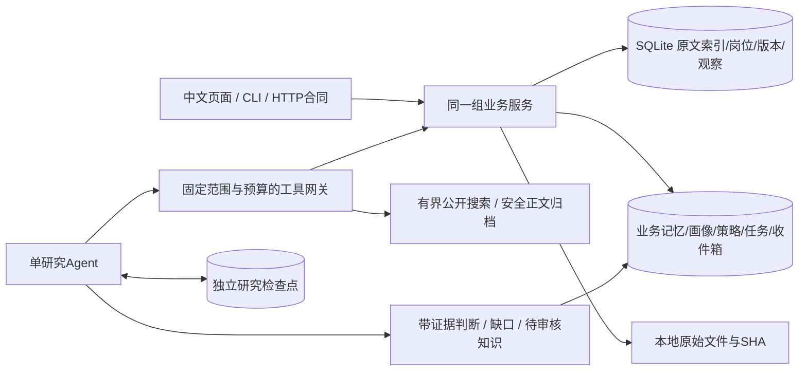

# 面试演示与设计取舍

2026-11-19。演示默认使用项目原创合成资料，避免展示私有招聘原始响应、访问参数、账号及密钥。真实研究证据只在本机私有目录保留；合成与真实调用分别说明。

## 十分钟演示

1. 按[部署说明](完整产品使用与部署.md)在新目录`demo-init`，启动页面。说明4岗位与5快照都是合成样例，初始化没有模型或招聘请求。
2. 查看“智能体应用工程师”原文、来源及未知发布时间。打开观察历史→比较最近正文版本，展示新增评测与告警职责。解释这是来源文字变化；改分类模型不应产生同类市场变化事件。
3. 在个人匹配填上海、月薪下限20000。展示符合、未知、已知不符及逐条件理由；日薪不换算成年薪，未披露用工主体不等于非外包。保存或修订明确条件，后续匹配使用新版本。
4. 研究工作台勾选两个岗位，先“仅整理证据”。说明离线结果不是模型成功；若已配置模型，可取消离线执行实际研究，查看计划→工具→原文→判断→缺口及复盘。没有凭据或额度时展示明确失败，不用录制结果冒充当前调用。
5. 点击引用核对原文与文件SHA。若查公开资料，搜索综合摘要与独立归档网页正文有不同标记，公开公司方向不能自动证明某岗位归属。工具只可读取当前搜索返回的公开网址，并有公网地址、重定向、大小和时间边界。
6. 在知识与偏好保存一个岗位范围的明确纠正，新研究重新召回；修订保留旧版本，撤回后停止默认使用。知识候选经过人工采纳才进入召回。忘记会清除关联派生研究、知识、画像、报告及通知，原始JD独立保留。
7. 演示中断研究→停止服务→重启→从历史继续。累计调用预算不重置；原候选和正文版本保持不变。常规查询在研究等待时仍可用，同库跨进程研究与采集分别有操作系统互斥。
8. 检索与评测提出别名候选，运行锁定6题。展示纯字面基线与候选、逐例来源版本、预算护栏、通过/拒绝/证据不足。通过后显式启用，再检查护栏和回退，展示事件与旧报告影响。强调这些是合成检索机制指标，不是全市场召回或研究语义准确率。
9. 观察与更新中保存规则版本与待研究问题。每日时段默认关闭；当前真实BOSS暂停时执行入口停用且服务端网络前拦截。展示采集失败是运行问题，不是零需求或撤招。收件箱能标已读、已处理，后续问题能带入研究。
10. 打开接口说明与OpenAPI，再停止服务执行完整备份→恢复到新目录→诊断→启动，证明原文、研究和版本不依赖聊天上下文。收尾停止验收服务。

## 架构如何解释

- SQL负责确定筛选和分母，检索负责有限证据，模型负责语义和下一步调查。把Top-K命中数当总体占比会混淆两者。
- 原文和观察是来源事实，画像、领域与知识是派生判断；业务库记录权威版本，报告不是独立新来源，检查点不是长期知识。
- 没有为架构完整性引入多Agent、Redis或独立向量库。当前别名/关键词基线先用固定评测检验；需要语义召回时，应在同一冻结资料与标注问题上验证新增成本及真实改善。
- 一次研究不是固定串联模板：Agent能选择读取、检索、统计、历史或公开补查；来源归档、身份、数值统计和权限校验仍由固定程序处理。
- 状态保存与网络事务分离。模型调用前记预算尝试，取消/崩溃不获得免费重试；恢复按原执行版本继续，业务服务用稳定身份和唯一约束避免重复写事实。
- 候选不能修改评测夹具或放宽门槛，先与当前基线配对，基线变化后需要重评；回退不删除已采集原文，失败策略不能直接再启用。
- 部署边界是单用户产品，私有后端配HTTPS反向代理。当前没有多租户、公开资料共享或招聘动作权限，不能把本机通过说成任意公网环境已上线。

## 可展示的真实证据

G6实际研究在两个已有JD上完成6次模型调用、一次公开搜索、13判断，并验证跨研究知识复用；随后实际工作画像5次调用形成11判断，缓存读取不再调用模型。明确官网正文也已实际归档并核对SHA。这些结果与真岗位都在被忽略的本机目录，不能随演示包分发。

没有测过的规模、准确率、节省费用或多天运行不得写入简历。240项曾通过的阶段检查是当时工程机制证据，最终新增导入及发布检查以[当前验收](完整产品验收清单.md)的最新数量为准。Docker构建、具体服务器TLS及暂停招聘源的无人运行仍需要对应环境验收。
